# 网影猎手 NetShadow Hunter — 总体方案、技术路线与软件架构

> 项目版本：`0.1.0`  
> 文档性质：需求、功能详设、总体架构、解决方案、技术路线、软件架构的合并版  
> 代码基线：以当前仓库 `src/`、`resources/`、`electron-builder.yml` 实现为准  
> 合并说明：本文由原 `01`–`06` 六份文档合并而成，`docs/` 下只保留这一份。

---

## 目录

1. 第一部分 需求与范围
2. 第二部分 功能详设
3. 第三部分 总体架构
4. 第四部分 总体解决方案
5. 第五部分 技术路线
6. 第六部分 软件架构
7. 附录：快速索引、命令与术语

---

## 0. 快速索引

| 动作 | 路径/命令 |
|------|-----------|
| 开发 | `npm run dev` |
| 测试 | `npm test` |
| 类型检查 | `npm run typecheck` |
| 生产编译 | `npm run build` |
| 便携目录 | `npm run package:dir` → `dist/win-unpacked/` |
| 便携压缩包 | `npm run package:portable` → `dist/网影猎手-<version>-portable.zip` |
| 内置引擎 | `resources/bin/{yt-dlp,ffmpeg,ffprobe}.exe` |
| 用户设置 | `userData/settings.json` |
| 队列/历史 | `userData/queue.json`、`userData/history.json` |
| 主进程入口 | `src/main/index.ts` |
| 渲染状态 | `src/renderer/src/store.ts` |
| 共享参数/解析 | `src/shared/ytdlp.ts` |


---

## 第一部分 需求与范围


> 对应产品：网影猎手 NetShadow Hunter `0.1.0`  
> 依据：仓库当前实现（`src/`、`resources/`、`electron-builder.yml`），而非历史 README 中的过时能力描述。

---

### 1. 背景与问题

用户要保存网页上的公开视频/音频时，通常需要：

1. 打开站点 → 找到具体作品页；
2. 用命令行调用 [yt-dlp](https://github.com/yt-dlp/yt-dlp)（有时还要 ffmpeg）；
3. 选择格式、指定输出目录、观察进度、失败后再试。

门槛高点在于：**命令行参数、Cookie/代理、合并音视频、Windows 下中文路径乱码**等。网影猎手要把「浏览 + 一键下载 + 队列」收敛成一个桌面窗口，同时**不重新实现各站解析**（解析仍交给 yt-dlp）。

---

### 2. 产品目标

#### 2.1 核心目标

| ID | 目标 | 验收要点 |
|----|------|----------|
| G1 | 内嵌浏览 | 窗口左侧可打开 http(s) 页面；有后退/前进/刷新/主页/地址栏 |
| G2 | 一键下载 | 在具体作品页点「下载此页」→ 自动探测 → 按片源最高开下 |
| G3 | 队列可视 | 右侧显示进度、状态、打开文件/文件夹、重试/移除 |
| G4 | 引擎就地可用 | 优先使用打包内置的 `resources/bin` 中 yt-dlp / ffmpeg |
| G5 | 便携分发 | 可提供 `win-unpacked` / zip，无需 NSIS 安装向导即可运行 |

#### 2.2 体验目标（体验）

- 深色主题、无边框窗口控件；
- 侧栏快捷入口：Bilibili / 抖音 / YouTube / 小红书；
- 设置页仅保留「保存目录」「同时下载数」「关于」；
- 失败时错误可读；成功时即便控制台路径乱码也能找回真实文件（编码/按 id 回落）。

---

### 3. 目标用户

| 角色 | 特征 | 主要诉求 |
|------|------|----------|
| 普通保存者 | 会用浏览器，不熟命令行 | 打开页面 → 点一下 → 文件出现在目录 |
| 轻度创作者/剪辑 | 需要稳定 1080p/更高画质 | 「片源最高」自动取当前源可用最高档 |
| 自用运维/朋友圈分发 | 要拷贝文件夹就能跑 | 便携包 + 内置引擎，少依赖系统 PATH |

**非目标用户（当前不做专门优化）**：需要批量账号矩阵、绕过付费墙、字幕机翻、远程服务器无头批量抓取的专业爬虫运营。

---

### 4. 使用场景

#### 4.1 主路径：打开 B 站视频并下载

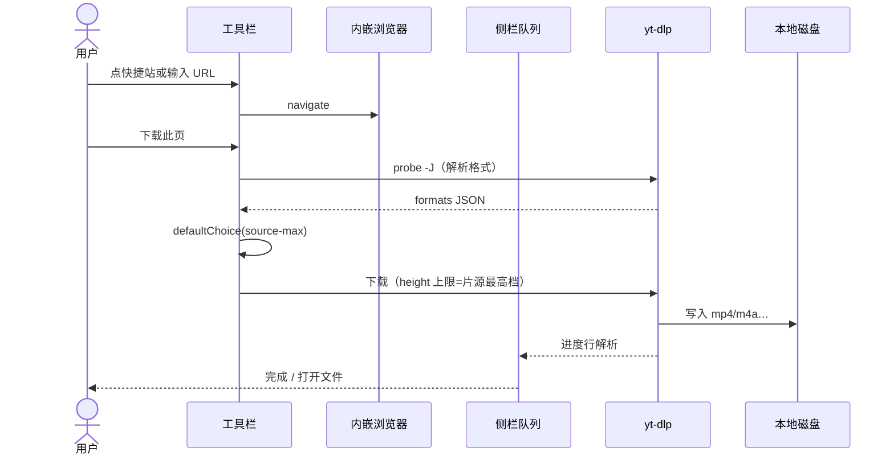

#### 4.2 场景表

| 场景 | 前置 | 步骤 | 期望结果 |
|------|------|------|----------|
| S1 公开视频 | 引擎就绪 | 打开作品页 → 下载此页 | 队列出现任务并完成 |
| S2 仅音频页 | 源有音频轨 | 同上（片源无视频高时可能落到音频预设） | 得到音频或合理失败提示 |
| S3 改保存目录 | 进入设置 | 改「默认保存目录」 | 后续任务写入新目录 |
| S4 并发 | 多个任务 | 设置同时下载数 1–5 | 同时 downloading 数不超过设定 |
| S5 网页自触发下载 | 页面点站内下载 | 浏览器 will-download | 以 `engine: browser` 进队列 |
| S6 引擎缺失 | 无 bin / PATH | 侧栏「下载引擎」 | 尝试拉取 yt-dlp 到 userData |
| S7 便携运行 | 解压 zip | 双击 `netshadow-hunter.exe` | 不依赖安装向导 |

#### 4.3 主路径示意（ASCII）

```text
[浏览] → [下载此页] → [probe -J] → [source-max 选档]
       → [spawn yt-dlp] → [解析 stdout] → [verifyOutput]
       → [completed | error]
```

---

### 5. 功能范围（In Scope）

当前界面与逻辑**包含**：

1. **浏览壳**：Toolbar、BrowserView、起始页 `resources/home.html`  
2. **下载编排**：probe → source-max → start → 队列/历史  
3. **FormatPicker**：probe 过程中可短暂展示（加载态）；组件内仍保留高级手动选档 UI，但主路径不再停留在「每次询问」  
4. **设置**：保存目录、并发、关于；返回浏览按钮（橙色 CTA 样式）  
5. **引擎**：bundled / PATH / userData 安装；侧栏状态与「下载引擎」  
6. **便携打包**：`electron-builder --dir` → `dist/win-unpacked`

---

### 6. 非目标（Out of Scope / 已移除或未暴露）

下列能力**不是当前产品表面**（代码里或许仍有字段/遗留，但 UI 不再提供或主路径不使用）：

| 项目 | 说明 |
|------|------|
| 设置里的「默认格式」 | 已移除；运行时固定按 `source-max` |
| 任务卡「命令」展开 | 已移除 |
| 设置里的代理 / Cookie 开关 / 文件名模板 / yt-dlp·ffmpeg 路径表单 | 设置页无对应控件（`Settings` 类型里仍有字段，sanitize 时写死或默认） |
| Cookie 跟随登录态 | MVP：`useCookies: false`，不写 cookie jar 给下载 |
| SoundCloud / Bandcamp 快捷入口 | 起始页与侧栏均为四站：Bilibili、抖音、YouTube、小红书 |
| 绕过 DRM / 付费墙 / 验证码自动破解 | 明确不做 |
| 账号体系、云同步、远程下载 | 不做 |
| macOS/Linux 一等公民发版 | 配置文件留有段落，但当前交付以 Windows 便携为主 |

---

### 7. 约束与质量属性

#### 7.1 技术约束

- 运行时：Electron（Chromium + Node）  
- UI：Vue 3 + Vite（electron-vite）  
- 解析/下载：外部进程 yt-dlp；合并/转码：ffmpeg  
- 主进程与渲染进程经 preload 白名单 IPC 通信  
- Windows 10/11 x64 为主要交付环境  

#### 7.2 合规与安全约束

- 用户只应下载有权保存的内容；关于页有声明  
- 不上传 Cookie、不分享账号  
- preload 只暴露有限 API，避免直接 `nodeIntegration`  
- 打开外部链接走 `shell.openExternal` 管控通道  

#### 7.3 可靠性约束

- 队列/历史落盘，异常退出后下载中任务恢复为可继续的 paused 语义  
- yt-dlp 退出码 0 后必须 `verifyOutput`；Windows 控制台路径乱码时按 `[id]` / BV 号在目录中回落查找  
- 暂停：结束 yt-dlp 子进程；继续：重新排队并依赖 `--continue`  

#### 7.4 性能与体验

- 并发下载默认 2，可调 1–5  
- 进度推送有节流（约 200ms）避免 UI 过热  
- 地址栏设 max-width，避免顶栏过挤  

---

### 8. 成功指标（建议）

| 指标 | 建议口径 |
|------|----------|
| 主路径成功率 | 公开 B 站/YouTube 样本页一次点下载成功率 |
| 引擎零配置率 | 便携包首次打开「引擎就绪」比例 |
| 误报失败率 | 文件已落盘但仍显示「找不到输出文件」应趋近 0 |
| 启动可用 | 便携目录拷贝到无安装机可直接运行 |

---

### 9. 术语表

| 术语 | 含义 |
|------|------|
| probe | 调用 yt-dlp `-J` 拉取格式 JSON |
| source-max / 片源最高 | 按探测到的最大 height，选择不超过该高度的最高档预设 |
| preset | `2160/1440/1080/720/480` 或音频三档 |
| BrowserView | Electron 内嵌网页视图（与 Vue 壳分离） |
| bundled | 打包进 `resources/bin` 的引擎 |
| win-unpacked | electron-builder dir 产物，免安装目录 |

---

### 10. 需求追踪 → 实现落点（摘要）

| 需求 | 主要代码 |
|------|----------|
| 浏览 | `src/main/browser.ts`, `Toolbar.vue` |
| 一键下载 | `store.ts#downloadThisPage`, `downloads.ts` |
| 片源最高 | `ytdlp.ts#defaultChoice('source-max')`, `recommendedPresets` |
| 队列 UI | `Sidebar.vue`, `TaskCard.vue` |
| 设置 | `SettingsView.vue`, `settings.ts` |
| 引擎 | `binaries.ts`, `resources/bin` |
| 便携包 | `electron-builder.yml` target `dir` |

更细的界面与流程见本文第二部分；进程与 IPC 见本文第三、六部分。

---

## 第二部分 功能详设


> 本文按**当前 UI 与代码真实行为**描述。若与根目录 README 冲突，以本文为准。

---

### 1. 信息架构

#### 1.1 视图状态机

应用渲染层用 `ui.view` 切换两大壳：

| `ui.view` | 界面 |
|-----------|------|
| `browse`（默认） | Toolbar + workspace（BrowserView 宿主 + Sidebar） |
| `settings` | SettingsView（无大标题「设置」，仅「返回浏览」+ 内容卡片） |

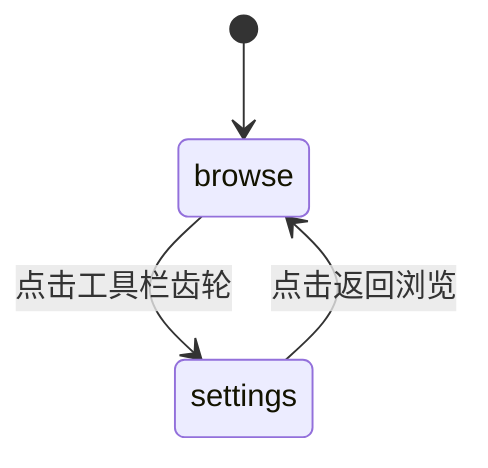

侧栏内部再用 `ui.tab`：`queue` | `history`。

#### 1.2 组件树

```text
App.vue
├── [browse]
│   ├── Toolbar.vue
│   │   └── WindowControls.vue
│   └── .workspace
│       ├── .browser-host
│       │   └── StartPane.vue          # Vue 空态层（叠在宿主上）
│       │       + BrowserView(home.html / 网页)  # 主进程管理
│       └── Sidebar.vue
│           ├── FormatPicker.vue       # ui.picker 存在时
│           ├── TaskCard.vue*
│           ├── 快捷访问 QUICK_SITES
│           ├── 打开下载文件夹
│           └── 引擎状态 / 下载引擎
└── [settings]
    └── SettingsView.vue
        └── WindowControls.vue
```

说明：用户看到的「首页四个站」主要来自 **BrowserView 加载的 `resources/home.html`**；`StartPane.vue` 也用同一套 `QUICK_SITES`，二者站点必须一致。

---

### 2. 工具栏（Toolbar）

#### 2.1 元素清单

| 区域 | 控件 | 行为 |
|------|------|------|
| 品牌 | 图标 +「网影猎手 / NETSHADOW」 | 展示 |
| 导航 | 后退 / 前进 / 刷新 / 起始页 | IPC `browser:*` |
| 地址栏 | input，placeholder「输入网址后回车」 | Enter → `commitAddress`；max-width ≈ 520px |
| 主操作 | 「下载此页」`.cta` | `downloadThisPage`；高度 24px、字号 11px、橙色胶囊 |
| 设置 | 齿轮 | `ui.view = 'settings'` |
| 窗口 | 最小化 / 最大化 / 关闭 | `window:*` |
| 加载条 | `.loadline` | `ui.browser.loading` 时显示 |

#### 2.2 「下载此页」可用性

```text
canDownload =
  desktop                                # 真实 Electron 窗口（非纯浏览器预览）
  && !ui.browser.isHome
  && ui.browser.url.startsWith('http')
  && !ui.picker?.loading
```

不满足时按钮 disabled（桌面端）；纯预览页会 toast「下载需要在桌面窗口里运行」。

#### 2.3 顶栏布局约束（CSS）

- `--toolbar-h: 40px`
- `.app`：`grid-template-rows: toolbar | 1fr`
- `.workspace`：`grid-template-columns: 1fr | var(--sidebar-w)`（约 340px）
- 拖拽区域：工具栏 `-webkit-app-region: drag`；交互控件 `no-drag`

---

### 3. 内嵌浏览器与起始页

#### 3.1 BrowserView

主进程 `browser.ts` 维护独立 BrowserView，根据渲染进程上报的 `.browser-host` 矩形 `setBounds`，使网页嵌在 Vue 壳的左侧区域。

| 能力 | IPC |
|------|-----|
| 导航 | `browser:navigate` |
| 后退/前进/刷新/主页 | `browser:back/forward/reload/home` |
| 同步状态 | bootstrap / `browser:get-state` + 推送字段到 `ui.browser` |
| 调整位置 | `browser:set-bounds` |

`isHome`：当前为本地 `home.html`（file: 且路径含 home.html）时为 true。

#### 3.2 起始页站点（必须一致）

`QUICK_SITES`（`src/shared/types.ts`）与 `resources/home.html`：

| 名称 | URL | 色点 |
|------|-----|------|
| Bilibili | https://www.bilibili.com | `#fb7299` |
| 抖音 | https://www.douyin.com | `#161823` |
| YouTube | https://www.youtube.com | `#ff4d4d` |
| 小红书 | https://www.xiaohongshu.com | `#ff2442` |

**已移除**：SoundCloud、Bandcamp（勿再写回文档当现网能力）。

侧栏「快捷访问」与起始页点击均走 `openQuick(url)` → 浏览器导航。

---

### 4. 侧栏：队列 / 最近

#### 4.1 队列 Tab

| 状态 | UI |
|------|----|
| `ui.picker` 有值 | 显示 `FormatPicker`（解析中或残留面板） |
| 无任务 | 空态文案 + 提示 |
| 有任务 | `TaskCard` 列表；可有「清除已完成」 |

#### 4.2 任务卡（TaskCard）

展示：缩略图、标题、格式标签、状态徽章、进度条、message/速度/ETA/体积、操作按钮。

| 状态 | 典型操作 |
|------|----------|
| downloading / queued | 暂停、取消 |
| paused / error | 继续 / 重试、取消或移除 |
| completed | 打开文件、打开文件夹、移除 |

**不展示**：「命令」展开行（已删除）。

#### 4.3 最近 Tab

历史记录：完成/失败/取消摘要；打开文件夹、移除、清空记录。持久化于 `userData/history.json`。

#### 4.4 底栏

1. **打开下载文件夹** → `settings.openPath(downloadDir)`  
2. **引擎状态**  
   - yt-dlp 或 ffmpeg `missing` →「引擎未就绪」  
   - 否则「引擎就绪」  
3. 缺失时显示 **下载引擎**（`binaries:install-ytdlp`，从 GitHub latest 拉 yt-dlp 到 userData）

---

### 5. 下载主流程（详设）

#### 5.1 总览

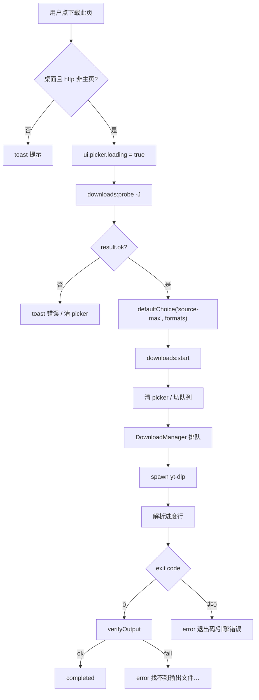

#### 5.2 Probe（解析）

- 命令要点：`yt-dlp -J --no-warnings` + `--no-playlist`（设置默认 `noPlaylist: true`）  
- 可选：`--ffmpeg-location`、`--proxy`（设置里无 UI，但字段存在且可被 IPC 写入）  
- JSON → `mapProbeJson` / `mapFormats`：去掉 storyboard；视频按 height 排序截断；音频截断  
- 播放列表且无 formats：返回友好错误，引导打开具体视频页  

#### 5.3 片源最高（source-max）

高度档位（从高到低）：

| PresetId | 标签 | yt-dlp 高度约束 |
|----------|------|-----------------|
| 2160 | 4K | `height<=2160` |
| 1440 | 2K | `height<=1440` |
| 1080 | 1080p | `height<=1080` |
| 720 | 720p | `height<=720` |
| 480 | 480p | `height<=480` |

`recommendedPresets(formats)`：仅保留 `maxVideoHeight >= 档位` 的项。  
`defaultChoice('source-max', formats)`：取 recommended 第一项（最高档）；若无视频高度则回落到音频预设第一项。

选择器偏好（`videoFormatSelector`）：

1. H.264 mp4 视频 + AAC 音频  
2. mp4 + m4a  
3. 泛化 `bv*+ba/b`  

并附带 `-S res,vcodec:h264,acodec:aac,ext:mp4:m4a`、`--merge-output-format mp4`。

**设置页不再提供「默认格式」**；主路径写死 `source-max`。`Settings.formatPreference` 在 sanitize 时强制为 `'source-max'`。

#### 5.4 FormatPicker 的现状角色

| 时刻 | 表现 |
|------|------|
| probe loading | 侧栏显示「正在读取可用格式…」 |
| 主路径成功 | 立刻 `confirmDownload`，面板关闭 |
| 组件仍保留 | 动态高度推荐、高级手动格式、仅音频三档等 UI |

即：详设上 FormatPicker **仍是可达组件**（加载态必经；高级 UI 代码仍在），但产品主路径是「不问格式、直接片源最高」。

#### 5.5 启动下载与并发

`DownloadManager.start`：

1. 规范化 URL；校验 choice  
2. `buildYtDlpArgs` 预校验（失败则抛错，不入队）  
3. 任务入队 `queued` → `pump`  
4. `pump`：同时 `downloading` 的 yt-dlp 任务数 < `concurrentDownloads` 则启动  

输出模板默认：`%(title)s [%(id)s].%(ext)s`（便于用 `[BVxxx]` 回落找文件）。

#### 5.6 进度与完成校验

- stdout/stderr：Windows 下若 UTF-8 解码出现 ``，尝试 GBK（`decodeYtDlpChunk`）  
- 额外参数：`--print after_move:filepath`，解析裸路径行  
- `verifyOutput`：`existsSync`；失败则按 URL/文件名中的 id（如 BV 号）扫描 `outputDir`，更新 `outputFile`  

#### 5.7 暂停 / 继续 / 取消

| 操作 | yt-dlp 引擎行为 |
|------|-----------------|
| 暂停 | kill 进程组；状态 paused；提示可继续 |
| 继续 | 重新 queued → 再跑（带 continue 相关参数） |
| 取消 | kill；cancelled |

浏览器引擎任务（will-download）：可真正 pause/resume DownloadItem。

#### 5.8 网页自触发下载

`session.will-download` → 生成 `engine: 'browser'` 任务，保存到默认下载目录（`uniquePath` 防重名）。

---

### 6. 设置页（SettingsView）

#### 6.1 顶栏

- 「返回浏览」：class `cta back-cta`，与「下载此页」同尺寸/同橙渐变，垂直居中于 `--toolbar-h`  
- **无**大标题「设置」  
- 右侧 WindowControls  

#### 6.2 可编辑项（仅此）

| 字段 | UI | 持久化 |
|------|----|--------|
| `downloadDir` | 输入框 + 浏览 | `settings.json` |
| `concurrentDownloads` | select 1–5 | 同上 |

#### 6.3 关于

版本号、产品一句话、版权合规提示。

#### 6.4 隐藏但仍存在于 Settings 类型的字段

写入时多被 sanitize 固定，例如：

- `formatPreference` → 恒 `'source-max'`  
- `useCookies` → `false`  
- `noPlaylist` → `true`  
- `ytdlpPath` / `ffmpegPath` → 存盘时常清空，依赖 bundled/PATH/检测  
- `theme` → 界面固定暗色提交  

这些**不是用户可配 UI**，文档勿写成设置项。

---

### 7. 引擎管理

#### 7.1 解析优先级（概念）

```text
自定义 settings 路径（若存在）
  → 项目/包内 resources/bin
  → PATH which
  → userData/bin（安装下载）
  → missing
```

打包后：`process.resourcesPath/bin/*.exe`。  
开发时：`cwd/resources/bin`。

#### 7.2 内置文件

```text
resources/bin/
  yt-dlp.exe
  ffmpeg.exe
  ffprobe.exe
```

`extraResources` 拷到安装/便携目录的 `resources/bin`。

#### 7.3 「下载引擎」

仅在 yt-dlp missing（或安装进行中）时强调；从 GitHub releases latest 下载官方二进制到 userData，并刷新 `binaries:info`。

ffmpeg 主要依赖捆绑或 PATH；设置页不提供路径填写。

---

### 8. 文件命名与路径

| 项 | 值 |
|----|----|
| 默认模板 | `%(title)s [%(id)s].%(ext)s` |
| Windows | `--windows-filenames` |
| 默认目录 | `app.getPath('videos')` 或 `downloads` |
| 用户设置文件 | `userData/settings.json` |
| 队列/历史 | `userData/queue.json`、`history.json` |

中文标题可保留；完成校验不依赖控制台打印的完美 UTF-8 路径。

---

### 9. 便携构建与运行

#### 9.1 命令

```bash
npm run package:dir
# 或
npm run package:portable
```

`electron-builder.yml` 中 `win.target: dir`（非默认 NSIS 安装包流程）。

#### 9.2 产物

```text
dist/win-unpacked/
  netshadow-hunter.exe
  resources/
    bin/yt-dlp.exe
    bin/ffmpeg.exe
    bin/ffprobe.exe
    home.html
    app.asar …
dist/网影猎手-0.1.0-portable.zip   # 对 win-unpacked 打包的压缩副本
```

用户：解压 → 运行 exe。无需安装向导、无需再下安装包。

---

### 10. 边界与错误文案（摘录）

| 情况 | 用户可见 |
|------|----------|
| 主页点下载 | 请先打开 http(s) 页面 |
| 非桌面预览 | 下载需要在桌面窗口里运行 |
| 播放列表页 | 提示打开具体视频或关闭仅当前条目（设置默认 noPlaylist） |
| 退出码 0 但路径乱码 | 回落扫描成功则完成；否则「找不到输出文件：…」 |
| 引擎缺失 | 侧栏未就绪 + 下载引擎 |

---

### 11. 功能 ↔ 文件对照表

| 功能块 | 关键文件 |
|--------|----------|
| 工具栏 | `Toolbar.vue`, `WindowControls.vue` |
| 浏览器 | `browser.ts`, `resources/home.html`, `StartPane.vue` |
| 下载按钮流程 | `store.ts`, `downloads.ts`, `ytdlp.ts` |
| 队列 | `Sidebar.vue`, `TaskCard.vue` |
| 解析面板 | `FormatPicker.vue` |
| 设置 | `SettingsView.vue`, `settings.ts` |
| 引擎 | `binaries.ts`, `resources/bin` |
| IPC 边界 | `ipc.ts`, `preload/index.ts` |
| 样式 | `styles/app.css` |

架构层说明见本文第三部分。

---

## 第三部分 总体架构


> 技术栈：Electron + Vue 3 + electron-vite + TypeScript；下载引擎 yt-dlp / ffmpeg。  
> 本文描述**进程划分、模块职责、IPC、数据流、打包布局**。

---

### 1. 鸟瞰

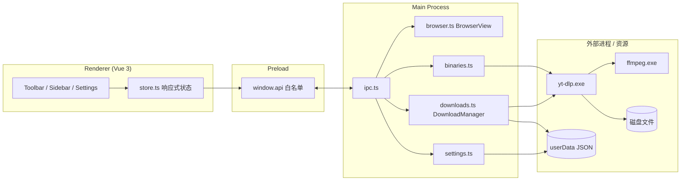

```text
┌────────────── Renderer ──────────────┐
│  Vue UI  ←→  store.ts (ui 单例)      │
└───────────────┬──────────────────────┘
                │ contextBridge
┌───────────────▼──────────────────────┐
│  preload → window.api.*                 │
└───────────────┬──────────────────────┘
                │ ipcMain.handle / send
┌───────────────▼──────────────────────┐
│  main: browser | downloads | settings│
│        binaries | window | shell     │
└───────────────┬──────────────────────┘
                │ spawn / fs
         yt-dlp / ffmpeg / JSON / 媒体文件
```

---

### 2. 仓库目录

```text
NetShadowHunter/
├── src/
│   ├── main/           # Electron 主进程
│   │   ├── index.ts    # 窗口生命周期、服务装配
│   │   ├── ipc.ts      # IPC 路由
│   │   ├── browser.ts  # BrowserView
│   │   ├── downloads.ts
│   │   ├── binaries.ts
│   │   ├── settings.ts
│   │   └── cookies.ts  # Cookie jar 工具（MVP 下载路径未启用跟随）
│   ├── preload/        # contextBridge
│   ├── renderer/       # Vue 应用
│   │   └── src/
│   │       ├── App.vue
│   │       ├── store.ts
│   │       ├── components/*
│   │       └── styles/app.css
│   └── shared/         # 双端共享
│       ├── types.ts
│       └── ytdlp.ts    # 参数组装、进度解析、选档
├── resources/
│   ├── home.html       # 浏览器起始页
│   ├── icon.png
│   └── bin/            # yt-dlp / ffmpeg / ffprobe
├── tests/              # 不启 Electron 的单元测试
├── docs/               # 本套文档
├── electron-builder.yml
├── electron.vite.config.ts
└── package.json
```

构建输出：

- 开发/编译：`out/main`、`out/preload`、`out/renderer`  
- 便携包：`dist/win-unpacked`  

---

### 3. 进程与安全边界

| 进程 | 职责 | Node 能力 |
|------|------|-----------|
| Main | 窗口、BrowserView、spawn、文件系统、session 下载 | 完整 |
| Preload | 把安全 API 挂到 `window.api` | 有限 |
| Renderer | UI 与交互状态 | **无**直接 Node（经 preload） |

安全相关实践：

- 渲染进程不直接 `require('fs')`  
- IPC 入参做基本校验（URL、formatId 字符集、代理 scheme 等在 `ytdlp.ts` / downloads）  
- `shell.openExternal` / 打开路径走主进程  

---

### 4. 主进程模块

#### 4.1 `index.ts`

- 创建 BrowserWindow（无边框等产品形态）  
- 加载 renderer（dev 为 Vite URL，prod 为 `out/renderer`）  
- 挂载 preload  
- 构造 `DownloadManager`、browser 控制器，注册 IPC  

#### 4.2 `browser.ts`

- 创建/销毁 BrowserView  
- 导航、历史、主页（`home.html`：开发用 `?asset` 路径，打包用 `process.resourcesPath/home.html`）  
- 与 renderer 同步 `BrowserState`  
- 根据 `set-bounds` 对齐左侧宿主矩形  

#### 4.3 `downloads.ts` — DownloadManager

核心状态：

```text
tasks: DownloadTask[]
history: HistoryItem[]
children: Map<taskId, ChildProcess>
```

职责摘要：

| 方法/区域 | 作用 |
|-----------|------|
| `probe` | spawn yt-dlp `-J`，映射 formats |
| `start` | 入队；`buildYtDlpArgs` 预校验 |
| `pump` / `run` | 并发控制与 spawn 下载 |
| `parseYtDlpLine` 应用 | 更新 progress/speed/eta/outputFile |
| `verifyOutput` | 成功落盘确认 + id 回落 |
| `pause/resume/cancel` | 进程与状态 |
| will-download | 浏览器引擎任务 |
| queue/history 持久化 | userData JSON |

Windows 编码：`decodeYtDlpChunk`（UTF-8 失败则试 GBK）。

#### 4.4 `binaries.ts`

- `projectBinPath`：打包 `resourcesPath/bin`，开发 `cwd/resources/bin`  
- `detectBinaries`：解析 yt-dlp / ffmpeg 槽位（path/version/source）  
- `installYtdlp`：从 GitHub latest 下载到 userData  

#### 4.5 `settings.ts`

- 路径：`join(app.getPath('userData'), 'settings.json')`  
- `sanitizeSettings`：强制 `formatPreference: 'source-max'`、`useCookies: false`、`noPlaylist: true` 等  
- 默认 `downloadDir`：`videos` 或 `downloads`；`concurrentDownloads: 2`  

#### 4.6 `cookies.ts`

提供 `writeCookieJar` / `removeCookieJar`。当前下载主路径 **MVP 关闭 Cookie 跟随**（`useCookies: false`，不向 yt-dlp 传 cookies 文件），但删除 jar 的清理调用仍保留在流程 finally 中以保持安全。

---

### 5. 共享层 `shared/ytdlp.ts`

| 导出 | 用途 |
|------|------|
| `normalizeUrl` | 补全 https、拒绝非 http(s) |
| `buildYtDlpArgs` | 组装最终 argv |
| `videoFormatSelector` | 按 height 生成 `-f` 链 |
| `recommendedPresets` / `maxVideoHeight` | 动态高度档 |
| `defaultChoice` | source-max / 固定档 / 音频 |
| `mapProbeJson` / `mapFormats` | `-J` → UI 结构 |
| `parseYtDlpLine` | 进度与路径行 |
| `previewCommand` | 测试与调试用命令串（任务卡不再展示） |

高度档常量：`2160/1440/1080/720/480`；音频：`audio-mp3|m4a|best`。

---

### 6. 渲染层

#### 6.1 `store.ts`

- 全局 `ui` reactive：settings、binaries、browser、tasks、history、picker、toast、view、tab…  
- `init`：`app:bootstrap` 灌入状态并订阅变更  
- `downloadThisPage`：probe → `defaultChoice('source-max')` → `confirmDownload`  
- 其余：队列操作、设置保存、引擎安装、打开目录等  

#### 6.2 关键组件

见本文第二部分组件树。样式集中于 `styles/app.css`（含 `--toolbar-h`、`--pad-side`、侧栏与 CTA token）。

---

### 7. IPC 目录

#### 7.1 invoke（渲染 → 主）

| Channel | 用途 |
|---------|------|
| `app:bootstrap` | 初始包：settings/binaries/browser/tasks/history/version |
| `browser:navigate/back/forward/reload/home/get-state/set-bounds` | 浏览器 |
| `downloads:probe` / `probe-cancel` | 解析 |
| `downloads:start/pause/resume/cancel/remove/clear-finished` | 队列 |
| `downloads:open-file` / `show-folder` / `list` | 文件与列表 |
| `downloads:history` / `clear-history` / `remove-history` | 历史 |
| `settings:get/set/choose-dir/open-path` | 设置与路径 |
| `binaries:info` / `install-ytdlp` | 引擎 |
| `window:minimize/maximize/close/is-maximized` | 窗控 |
| `shell:open-external` / `shell:copy` | 外壳 |

#### 7.2 主 → 渲染事件（节选）

| Channel | 用途 |
|---------|------|
| `downloads:task` / `downloads:list` / `downloads:history` | 队列推送 |
| `settings:changed` | 设置更新 |
| `binaries:info` / `binaries:install-progress` | 引擎 |
| `window:maximized` | 最大化状态 |

Preload 聚合为：`window.api.browser|downloads|settings|binaries|shell|window`。

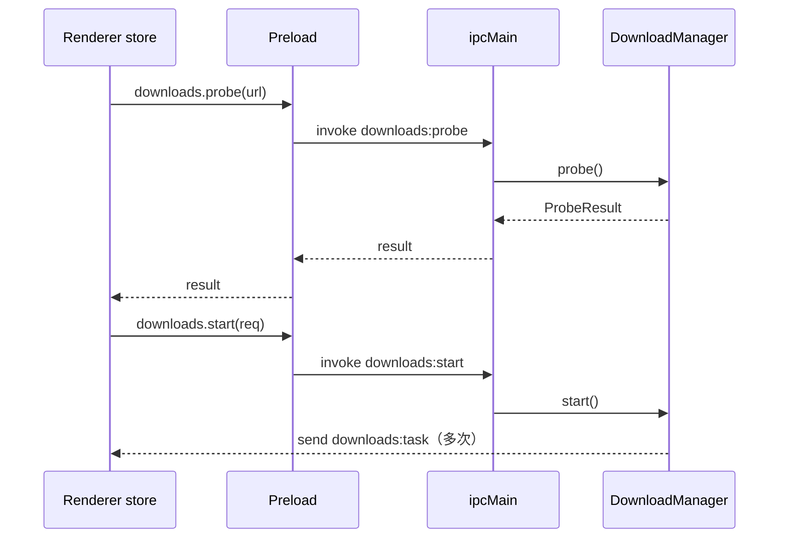

---

### 8. 关键数据流：一键下载

```text
Toolbar.click
  → store.downloadThisPage
      → ui.picker = { loading:true }
      → api.downloads.probe
      → defaultChoice('source-max', formats)
      → api.downloads.start
      → ui.picker = null
  → DownloadManager.run
      → spawn yt-dlp (PYTHONUTF8 / decode GBK fallback)
      → applyLine / verifyOutput
      → persist queue + history
      → send downloads:task
```

持久化时机：任务变更 `persistSoon`（约 250ms debounce）写 `queue.json` / `history.json`。

---

### 9. 配置与用户数据

| 项 | 位置 |
|----|------|
| 设置 | `%APPDATA%/<app>/settings.json`（具体 app 名随 Electron userData） |
| 队列 | `queue.json` |
| 历史 | `history.json` |
| 可选安装的 yt-dlp | `userData/bin/yt-dlp.exe` |
| 媒体输出 | 用户配置的 `downloadDir`（常见如 `D:\Video` 或系统视频库） |

`Settings` 接口字段完整列表见 `src/shared/types.ts`；**UI 仅编辑** `downloadDir`、`concurrentDownloads`。

---

### 10. 构建与打包架构

#### 10.1 开发

```bash
npm run dev   # electron-vite：主进程 + preload + renderer HMR
```

Renderer 开发服务器默认文档记载为 `http://127.0.0.1:44731`（以实际控制台为准）。纯浏览器打开只能预览壳，**没有** BrowserView 与真实下载。

#### 10.2 生产编译

```bash
npm run build   # typecheck + electron-vite build → out/
```

#### 10.3 便携目录包

```bash
npm run package:dir
# package.json: "package:portable": "npm run build && electron-builder --win dir"
```

`electron-builder.yml` 要点：

| 键 | 值 |
|----|----|
| `appId` | `app.netshadow.hunter` |
| `productName` | 网影猎手 |
| `win.executableName` | `netshadow-hunter` |
| `win.target` | **`dir`**（非 NSIS 默认交付） |
| `extraResources` | `home.html` → `resources/home.html`；`resources/bin/**` → `resources/bin/**` |

```text
dist/win-unpacked/
├── netshadow-hunter.exe
├── *.dll / pak / locales ...
└── resources/
    ├── app.asar
    ├── home.html
    └── bin/
        ├── yt-dlp.exe
        ├── ffmpeg.exe
        └── ffprobe.exe
```

压缩包（发版时常做）：`dist/网影猎手-0.1.0-portable.zip`。

> 配置文件中仍保留 `nsis` / mac / linux 段落，便于将来扩展；**当前推荐交付物是 dir/zip 便携形态**。

---

### 11. 测试策略

`tests/ytdlp.test.ts`（tsx）：

- URL 规范化  
- `buildYtDlpArgs` 预设与安全拒绝  
- 进度行解析  
- `mapProbeJson`  
- `recommendedPresets` / `defaultChoice('source-max')` / after_move 路径行  

不启动 Electron；UI / BrowserView / 真下载靠手工或后续 E2E。

---

### 12. 关键扩展点（给后续迭代）

| 方向 | 建议挂载点 | 注意 |
|------|------------|------|
| 恢复「每次询问」 | `downloadThisPage` 分支 + FormatPicker 停留 | 需产品开关，勿默默改回 |
| Cookie 跟随 | `cookies.ts` + `useCookies` | 合规与安全提示 |
| 代理 UI | `Settings.proxy` 已有字段 | 校验 scheme |
| 自定义图标 | `electron-builder` win.icon | 现默认 Electron 图标 |

---

### 13. 架构决策记录（简）

| 决策 | 理由 |
|------|------|
| 不自研解析 | 复用 yt-dlp 站点覆盖与更新节奏 |
| source-max 默认一键下 | 降低选择成本；高级面板保留代码能力 |
| BrowserView 而非 webview 标签页 | 与壳布局分离、易控 bounds |
| 便携 dir 优先 | 满足「不用安装包/少下载」分发 |
| 完成校验 + id 回落 | 修复 Windows 控制台中文路径误报失败 |

---

### 14. 相关代码入口

- 应用入口：`src/main/index.ts`、`src/renderer/src/App.vue`、`src/shared/ytdlp.ts`
- 说明：原分散文档已合并到本文对应章节。

---

## 第四部分 总体解决方案


> 项目：网影猎手 NetShadow Hunter  
> 版本：`0.1.0`  
> 文档性质：产品与技术解决方案（Solution Design）  
> 代码基线：以当前仓库 `src/` 实现为准  
> 章节：本文为合并版，相关背景见第一至第三部分。

---

### 1. 文档定位

本文回答三个问题：

1. 网影猎手要解决什么问题；
2. 用什么产品形态和技术组合解决；
3. 当前版本已经做到什么、还缺什么。

本文不替代功能详设和实现级架构文档：

- 需求范围见本文第一部分
- 界面和交互细节见本文第二部分
- 进程与模块全景见本文第三部分
- 实现级模块、状态机、IPC 细节见本文第六部分

---

### 2. 问题定义

用户经常遇到这样的场景：

- 在网页里看到想保存的视频或音频；
- 不想手动复制链接、切换命令行、记 yt-dlp 参数；
- 希望在一个窗口里完成“浏览 → 选择 → 下载 → 查看进度”；
- 希望下载引擎和转码引擎随应用一起分发，不要求用户自己配环境。

传统做法的痛点：

| 做法 | 问题 |
|------|------|
| 直接用浏览器 | 只能看，不能按格式保存 |
| 复制链接到命令行 | 需要知道 yt-dlp 参数、格式选择、输出目录 |
| 使用在线下载站 | 隐私、广告、限速、稳定性不可控 |
| 自己解析站点 | 维护成本高，站点一改就失效 |

本项目选择**复用 yt-dlp 的站点解析能力**，自己只做桌面壳、内嵌浏览、格式选择、队列编排和本地文件管理。

---

### 3. 产品定位与边界

#### 3.1 产品定位

**网影猎手**是 Windows 优先的开源桌面客户端：

> 左侧内嵌 Chromium 浏览网页，右侧管理下载队列；用户打开页面后点“下载此页”，由本机 yt-dlp 解析格式并下载，必要时调用 ffmpeg 合并或转码。

#### 3.2 明确不做

| 不做 | 原因 |
|------|------|
| 自研站点解析器 | 复用 yt-dlp 的 extractor 覆盖和更新节奏 |
| 绕过 DRM / 付费墙 | 合规边界；DRM 内容不支持 |
| 账号共享、Cookie 上传 | 登录态只在本机使用 |
| 在线视频托管/分发 | 只保存到用户本地目录 |
| 多标签浏览器 | 当前是单内嵌浏览器视图，降低复杂度 |
| 全平台安装包优先 | 当前主交付是 Windows 便携目录/zip |

#### 3.3 合规定位

应用只负责：

- 打开用户指定的网页；
- 调用本机 yt-dlp；
- 把用户选择的内容保存到本地；
- 展示进度和历史。

应用不提供内容源、不绕过授权、不传播下载文件。

---

### 4. 目标与非目标

#### 4.1 核心目标

1. **一个窗口完成浏览和下载**
2. **尽量少配置**：内置 yt-dlp / ffmpeg / ffprobe，开箱可用
3. **格式可理解**：推荐清晰度档位，同时保留高级手动格式
4. **队列可控**：并发、暂停、继续、取消、历史记录
5. **Windows 友好**：处理中文路径、GBK 输出、文件名非法字符
6. **便携分发**：`win-unpacked` 目录 + portable zip

#### 4.2 非目标

- 不做视频编辑；
- 不做云端同步；
- 不做浏览器扩展；
- 不做站点账号管理；
- 不承诺所有 yt-dlp 支持的站点都能 100% 成功；
- 不解决 DRM 内容下载。

---

### 5. 总体解决方案

#### 5.1 一句话方案

```text
Electron 桌面壳
  + WebContentsView 内嵌浏览器
  + Vue 3 渲染界面
  + yt-dlp 解析/下载
  + ffmpeg/ffprobe 合并转码
  + 本地 JSON 持久化
  + electron-builder 便携打包
```

#### 5.2 用户主流程


#### 5.3 系统分层

```text
┌─────────────────────────────────────────────┐
│ Renderer：Vue 3 UI                          │
│ Toolbar / BrowserHost / Sidebar / Picker    │
├─────────────────────────────────────────────┤
│ Preload：window.api 白名单                  │
├─────────────────────────────────────────────┤
│ Main：窗口 / 浏览器 / 下载队列 / 引擎 / 设置 │
├─────────────────────────────────────────────┤
│ External：yt-dlp / ffmpeg / ffprobe          │
├─────────────────────────────────────────────┤
│ Storage：settings.json / queue.json / history│
└─────────────────────────────────────────────┘
```

---

### 6. 核心能力设计

#### 6.1 内嵌浏览器

- 使用 Electron `WebContentsView`，不是 `<webview>` 标签；
- 独立持久化分区 `persist:netshadow-browser`；
- 设置自定义 Chrome User-Agent；
- 渲染层通过 `ResizeObserver` 把浏览器宿主矩形同步给主进程；
- 主进程根据 bounds 调整 `WebContentsView` 大小；
- 进入设置页时隐藏浏览器视图，返回浏览页时恢复。

设计理由：

- 浏览内容和应用 UI 分离；
- 可以精确控制 bounds，避免 CSS 布局和原生视图错位；
- 独立 session 便于后续做 Cookie 导出和登录态隔离。

#### 6.2 页面解析与格式选择

解析流程：

1. 渲染层调用 `downloads:probe(url)`；
2. 主进程 spawn `yt-dlp -J --no-warnings`；
3. `mapProbeJson()` 把 yt-dlp JSON 映射成 `MediaFormat[]`；
4. 过滤 storyboard、mhtml 等非媒体格式；
5. 视频按高度/编码/码率去重并排序；
6. 渲染层展示推荐清晰度、音频预设和高级格式。

推荐策略：

- 默认 `source-max`：优先源站最高可用高度；
- 推荐档位只显示不超过源站最高高度的档位；
- 视频优先 H.264 + AAC + MP4，兼容 Windows 播放器；
- 没有视频高度时回落到音频预设。

#### 6.3 下载队列

`DownloadManager` 维护：

- `tasks`：当前任务；
- `history`：最近完成/失败/取消记录；
- `children`：运行中的子进程；
- `stopReason`：暂停/取消原因；
- `probeChild`：当前解析进程。

调度策略：

```text
queued 任务
  → 当前 downloading 数量 < concurrentDownloads
  → 启动 yt-dlp
  → 完成/失败/取消后释放槽位
  → 继续调度下一个 queued
```

并发数由设置页控制，范围 1–5。

#### 6.4 暂停、继续、取消

| 操作 | 实现 |
|------|------|
| 暂停 yt-dlp 任务 | 结束当前子进程，标记 `paused`，继续时重新排队 |
| 继续 | 状态回到 `queued`，重新 spawn，依赖 `--continue` 续传 |
| 取消 | 结束子进程，标记 `cancelled` |
| 暂停网页下载 | 调用 Electron `DownloadItem.pause()` |
| 继续网页下载 | 调用 `DownloadItem.resume()` |
| 取消网页下载 | 调用 `DownloadItem.cancel()` |

注意：yt-dlp 的“暂停”不是进程内暂停，而是**杀掉当前进程后重新开始并续传**；网页原生下载则是真正的 DownloadItem 暂停。

#### 6.5 进度与输出校验

yt-dlp 输出解析：

- `--newline` 保证按行输出；
- `--print after_move:filepath` 输出最终文件路径；
- `parseYtDlpLine()` 解析百分比、速度、ETA、大小、合并/转码状态、错误；
- Windows 中文环境如果 UTF-8 解码出现乱码，尝试 GBK 回退；
- 完成后 `verifyOutput()` 检查文件是否存在、是否 0 字节；
- 如果 `after_move` 路径不可用，按 URL/文件名中的 BV 号等标识在输出目录回找。

#### 6.6 引擎管理

引擎解析优先级（当前代码）：

```text
settings 自定义路径（预留，但当前 sanitize 会清空）
  → 项目/包内 resources/bin
  → PATH
  → missing
```

内置文件：

```text
resources/bin/
  yt-dlp.exe
  ffmpeg.exe
  ffprobe.exe
```

“下载引擎”功能：

- 从 GitHub Releases latest 下载官方 yt-dlp；
- 保存到 `userData/bin/yt-dlp.exe`；
- 下载过程通过 IPC 推送进度；
- 当前代码存在一个待修问题：安装到 `userData/bin` 后，`detectBinaries()` 的候选列表没有包含该路径，可能导致下次检测不到刚下载的引擎。

#### 6.7 设置与持久化

当前设置页只暴露：

- 默认保存目录；
- 同时下载数（1–5）。

持久化文件：

| 文件 | 内容 |
|------|------|
| `userData/settings.json` | 设置 |
| `userData/queue.json` | 当前任务队列 |
| `userData/history.json` | 最近历史（最多 100 条） |

写入采用约 250ms debounce，避免进度刷新时频繁写盘。

#### 6.8 便携分发

当前主交付形态：

```text
dist/win-unpacked/
  netshadow-hunter.exe
  resources/
    app.asar
    app.asar.unpacked/
    home.html
    bin/
      yt-dlp.exe
      ffmpeg.exe
      ffprobe.exe
```

`npm run package:portable` 会：

1. typecheck + electron-vite build；
2. electron-builder `--win dir` 生成 `dist/win-unpacked`；
3. 自动压缩为 `dist/网影猎手-<version>-portable.zip`。

---

### 7. 关键设计决策

| 决策 | 选择 | 理由 |
|------|------|------|
| 站点解析 | 复用 yt-dlp | 覆盖广、更新快、避免自研维护 |
| 桌面框架 | Electron | 内嵌 Chromium、跨平台、生态成熟 |
| 浏览器视图 | WebContentsView | 与 UI 分离，bounds 可控，替代旧 BrowserView |
| 前端框架 | Vue 3 + reactive store | 轻量、组件化、开发速度快 |
| 构建工具 | electron-vite + Vite | 主/预加载/渲染统一构建，HMR 快 |
| 打包 | electron-builder `dir` | 便携优先，减少安装器复杂度 |
| 默认选档 | source-max | 降低用户选择成本 |
| 视频编码 | H.264/AAC/MP4 优先 | Windows 播放器兼容性好 |
| 状态存储 | JSON 文件 | 轻量、易调试、无需数据库 |
| 下载引擎 | 内置 + 可下载 | 开箱可用，同时允许补装 |

---

### 8. 安全与合规

#### 8.1 已采取的措施

- Renderer 不直接使用 Node；
- `contextIsolation: true`、`nodeIntegration: false`；
- 内嵌浏览器 `sandbox: true`；
- 外链打开走 `normalizeUrl()`，只允许 http/https；
- yt-dlp 使用 `shell: false`，避免命令注入；
- 格式 ID 使用白名单字符集；
- 代理必须匹配 http/https/socks5/socks5h；
- 下载文件名做非法字符清理和重名处理；
- Cookie 工具函数使用临时文件、0600 权限、用完删除（当前下载路径尚未启用）。

#### 8.2 当前安全缺口

| 缺口 | 影响 | 建议 |
|------|------|------|
| 主窗口 `sandbox: false` | Renderer 权限偏大 | 评估后改为 `sandbox: true` |
| 主窗口 `setWindowOpenHandler` 直接 `shell.openExternal(details.url)` | 任意协议可能交给系统处理 | 增加协议白名单 |
| Cookie 跟随未启用 | 登录站点下载能力受限 | 在合规前提下接入临时 Cookie |
| `settings` 中路径字段被 sanitize 清空 | 自定义引擎路径不可用 | 明确产品是否保留该能力 |
| `userData/bin` 未进入检测候选 | 下载引擎后可能仍显示 missing | 补充检测路径 |

#### 8.3 DRM 边界

本项目不实现 DRM 解密、密钥获取或许可证绕过。

遇到 DRM 内容时，合理行为是：

- 明确提示“不支持 DRM”；
- 不把失败误报成登录问题；
- 引导用户使用官方客户端离线缓存。

当前代码尚未做专门的 DRM 错误映射，只透传 yt-dlp 错误；这是后续可补的体验项。

---

### 9. 当前实现差距

> 以下为文档编写时的真实差距，避免把“预留能力”误写成“已实现能力”。

| 项目 | 当前状态 | 说明 |
|------|----------|------|
| Cookie 跟随 | 未启用 | `downloads.ts` 中 `cookies = null`，`useCookies: false` |
| 默认格式设置 | 固定 `source-max` | `sanitizeSettings()` 强制 |
| 播放列表开关 | 固定 `noPlaylist: true` | 设置字段存在但 UI 不可编辑 |
| 代理 | 字段存在，无 UI | `buildYtDlpArgs` 支持，设置页未暴露 |
| yt-dlp 安装路径 | 有安装逻辑 | 检测候选缺 `userData/bin`，需修 |
| 自定义 yt-dlp/ffmpeg 路径 | 类型存在 | `sanitizeSettings()` 会清空 |
| FormatPicker | 可用 | 当前流程会停留在选择面板，等待用户确认 |
| DRM 提示 | 未专门映射 | 依赖 yt-dlp 原始错误 |
| E2E 测试 | 无 | 目前只有 shared 层单元测试 |
| 代码签名 | 无 | 打包日志会提示 signing skipped |

---

### 10. 验收标准

#### 10.1 功能验收

- 应用能在 Windows 启动并显示自定义标题栏；
- 内嵌浏览器能打开 http/https 页面；
- 地址栏、前进、后退、刷新、主页可用；
- “下载此页”能解析出格式并展示选择面板；
- 选择视频/音频后能加入队列并开始下载；
- 进度、速度、ETA、完成状态可见；
- 暂停、继续、取消可用；
- 完成后能打开文件或所在文件夹；
- 网页自触发下载能进入队列；
- 设置能修改保存目录和并发数；
- 重启后队列和历史能恢复；
- portable zip 能解压即用。

#### 10.2 非功能验收

- 下载过程不阻塞 UI；
- 并发数限制生效；
- 子进程在暂停/取消/退出时被清理；
- 文件名非法字符被处理；
- 0 字节输出被判定为失败；
- 中文路径和 GBK 输出不乱码；
- 类型检查、单元测试通过；
- 打包产物包含 home.html 和 bin。

---

### 11. 后续演进

#### 11.1 近期（P0/P1）

1. 修复 `userData/bin` 引擎检测；
2. 给主窗口 `setWindowOpenHandler` 加协议白名单；
3. 评估主窗口 `sandbox: true`；
4. 增加 DRM 错误映射；
5. 在合规前提下恢复临时 Cookie 跟随；
6. 增加 `package:portable` 的产物校验。

#### 11.2 中期

1. 增加端到端测试；
2. 增加下载日志和诊断面板；
3. 增加 yt-dlp 版本检查/更新；
4. 增加签名和自动更新；
5. 优化安装包体积与语言包。

#### 11.3 长期

1. 多标签/多窗口浏览；
2. 下载任务分组和批量操作；
3. 站点快捷入口可配置；
4. 主题和 UI 定制；
5. 跨平台打包与发布流水线。

---

### 12. 相关代码入口

#### 代码入口

| 区域 | 文件 |
|------|------|
| 主进程装配 | `src/main/index.ts` |
| 浏览器视图 | `src/main/browser.ts` |
| 下载管理器 | `src/main/downloads.ts` |
| 引擎检测/安装 | `src/main/binaries.ts` |
| 设置 | `src/main/settings.ts` |
| Cookie 工具 | `src/main/cookies.ts` |
| IPC | `src/main/ipc.ts` |
| 渲染状态 | `src/renderer/src/store.ts` |
| 共享类型/参数 | `src/shared/types.ts`、`src/shared/ytdlp.ts` |

---

## 第五部分 技术路线


> 项目：网影猎手 NetShadow Hunter  
> 版本：`0.1.0`  
> 文档性质：技术路线与实施路径（Technical Roadmap）  
> 目标：说明“用什么技术、按什么顺序、如何验证”把方案落地。

---

### 1. 路线概览

项目采用一条清晰的技术主线：

```text
Electron 桌面壳
  → WebContentsView 内嵌浏览器
  → Vue 3 渲染界面
  → yt-dlp 解析与下载
  → ffmpeg/ffprobe 合并与转码
  → JSON 持久化队列/历史
  → electron-builder 便携打包
```

核心原则：

1. **不自研站点解析**：把站点适配交给 yt-dlp；
2. **主进程掌握系统能力**：文件、进程、下载、窗口、外链；
3. **渲染层只做 UI 和用户交互**：通过 preload 白名单访问主进程；
4. **共享层沉淀纯逻辑**：参数组装、进度解析、格式映射、选档；
5. **先跑通闭环，再补体验和工程化**。

---

### 2. 技术栈

| 层 | 技术 | 版本/说明 |
|----|------|-----------|
| 桌面运行时 | Electron | `^44.7.2`，构建日志实际使用 44.10.2 |
| 前端框架 | Vue 3 | `^3.5.44`，`<script setup>` + Composition API |
| 构建工具 | electron-vite | `^6.0.0` |
| 前端构建 | Vite | `^8.3.4`，安装版本 8.3.6 |
| 类型系统 | TypeScript | `^5.9.3`，strict |
| 打包 | electron-builder | `^26.15.3`，安装版本 26.18.0 |
| 测试 | tsx + Node test runner | `tsx --test tests/**/*.test.ts` |
| 下载引擎 | yt-dlp | 内置 `resources/bin/yt-dlp.exe`，也可下载到 userData |
| 转码引擎 | ffmpeg / ffprobe | 内置 `resources/bin/` |
| 代码规范 | ESLint + Prettier | `eslint`、`prettier`、`vue-eslint-parser` |
| 目标平台 | Windows 10/11 x64 | 当前主交付；mac/Linux 配置保留 |

---

### 3. 技术路线总图

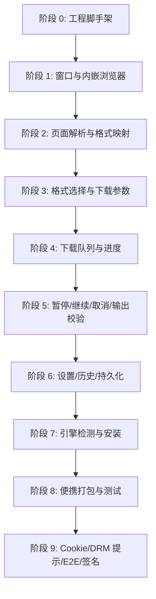

---

### 4. 分阶段实施

#### 阶段 0：工程脚手架

**目标**：建立可开发、可构建、可测试的 Electron + Vue 工程。

主要工作：

- 配置 `electron.vite.config.ts`；
- 配置 `tsconfig.node.json`、`tsconfig.web.json`；
- 配置 `electron-builder.yml`；
- 配置 ESLint / Prettier；
- 建立 `src/main`、`src/preload`、`src/renderer`、`src/shared` 目录。

验收：

- `npm run dev` 能启动窗口；
- `npm run build` 能生成 `out/`；
- `npm run typecheck` 通过。

#### 阶段 1：窗口与内嵌浏览器

**目标**：完成无边框窗口、自定义标题栏、内嵌浏览器和 bounds 同步。

关键实现：

- `BrowserWindow`：`frame: false`、`contextIsolation: true`、`nodeIntegration: false`；
- `WebContentsView`：独立 partition `persist:netshadow-browser`；
- `ResizeObserver` + `requestAnimationFrame` 把浏览器宿主矩形上报主进程；
- `browser:set-bounds` 控制 WebContentsView 位置和大小；
- 设置页切走时隐藏浏览器视图。

验收：

- 窗口可拖动、最小化、最大化、关闭；
- 内嵌浏览器能打开 http/https 页面；
- 调整窗口大小后浏览器视图与 UI 不错位；
- 设置页和浏览页切换正常。

#### 阶段 2：页面解析与格式映射

**目标**：用 yt-dlp 读取页面可用格式，并转成前端可展示的数据。

关键实现：

- `downloads:probe` → `yt-dlp -J --no-warnings`；
- `execProbe()`：90 秒超时、stdout/stderr 收集、错误提取；
- `mapProbeJson()` / `mapFormats()`：
  - 过滤 storyboard、mhtml；
  - 识别 video / audio / combined；
  - 映射高度、fps、编码、码率、文件大小；
  - 视频按高度/编码去重排序；
- 播放列表无 formats 时返回友好错误。

验收：

- Bilibili / YouTube 等页面能返回标题、缩略图、时长、格式列表；
- 不支持的页面返回可读错误；
- 解析过程不阻塞 UI；
- 解析可取消。

#### 阶段 3：格式选择与下载参数

**目标**：把用户选择转换成安全的 yt-dlp 参数。

关键实现：

- `PresetId`：4K / 2K / 1080p / 720p / 480p / MP3 / M4A / 原音质；
- `source-max`：取推荐档位中的最高项；
- `videoFormatSelector()`：H.264 + AAC + MP4 优先，逐级回退；
- `formatId` 白名单：`^[A-Za-z0-9._+-]+$`；
- 代理只允许 `http/https/socks5/socks5h`；
- spawn 使用 `shell: false`；
- 输出模板：`%(title)s [%(id)s].%(ext)s`。

验收：

- 推荐档位不超过源站最高高度；
- 无视频时回落到音频；
- 非法格式 ID 和非法代理被拒绝；
- 生成命令可通过单测验证。

#### 阶段 4：下载队列与进度

**目标**：实现可并发、可观测的下载队列。

关键实现：

- `DownloadManager` 维护 `tasks`、`history`、`children`；
- `pump()` 根据 `concurrentDownloads` 调度；
- `start()` 先预校验参数，再入队；
- `run()` spawn yt-dlp，实时解析 stdout/stderr；
- `parseYtDlpLine()` 解析：
  - 百分比、速度、ETA、大小；
  - Destination / Merger / ExtractAudio；
  - after_move 最终路径；
  - ERROR；
- 进度事件 200ms 节流。

验收：

- 多任务并发受设置限制；
- 进度、速度、ETA 正常显示；
- 下载失败能看到错误；
- 下载完成能拿到输出路径。

#### 阶段 5：暂停、继续、取消与输出校验

**目标**：让任务生命周期可控，避免“显示完成但文件不可用”。

关键实现：

- 暂停 yt-dlp：记录 `stopReason='pause'`，kill 进程树；
- 继续：状态回 `queued`，重新 spawn，带 `--continue`；
- 取消：记录 `stopReason='cancel'`，kill 进程树；
- 网页下载：`DownloadItem.pause()/resume()/cancel()`；
- `verifyOutput()`：检查存在性、0 字节、可读性；
- 找不到 after_move 路径时，按 BV 号/URL 标识回找；
- Windows GBK 解码回退。

验收：

- 暂停后能继续；
- 取消后不再产生完成事件；
- 0 字节文件判定失败；
- 中文文件名不误报。

#### 阶段 6：设置、历史与持久化

**目标**：让设置在重启后保留，任务和历史可恢复。

关键实现：

- `settings.ts`：读写 `userData/settings.json`；
- `sanitizeSettings()`：限制并发 1–5，固定部分字段；
- `queue.json`：恢复未完成任务，`downloading/queued` 转为 `paused`；
- `history.json`：最多 100 条；
- `persistSoon()`：250ms debounce；
- `shutdown()`：退出前 flush。

验收：

- 修改保存目录/并发数后重启仍生效；
- 重启后任务历史仍在；
- 重启后未完成任务显示“可继续”。

#### 阶段 7：引擎检测与安装

**目标**：让用户不配置环境也能使用。

关键实现：

- `detectBinaries()`：
  - 自定义路径（预留）；
  - 项目/包内 `resources/bin`；
  - PATH；
  - missing；
- `installYtdlp()`：
  - 从 GitHub Releases latest 下载；
  - 保存到 `userData/bin/yt-dlp.exe`；
  - 进度通过 `binaries:install-progress` 推送；
  - 运行 `--version` 校验；
- 设置页/侧栏显示引擎状态。

验收：

- 内置引擎可用时显示“引擎就绪”；
- 缺失时能触发下载；
- 下载失败有可读错误。

> 当前缺口：`detectBinaries()` 的候选列表尚未包含 `userData/bin`，需要补上，否则刚下载的引擎可能检测不到。

#### 阶段 8：便携打包与测试

**目标**：交付可解压即用的 Windows 便携包。

关键实现：

- `electron.vite.config.ts` 分别构建 main/preload/renderer；
- `electron-builder.yml`：
  - `win.target: dir`；
  - `extraResources` 复制 `home.html` 和 `resources/bin`；
  - `asarUnpack: resources/**`；
- `scripts/package-portable.ps1`：
  1. `npm run build`；
  2. `electron-builder --win dir`；
  3. `Compress-Archive` 生成 `dist/网影猎手-<version>-portable.zip`；
- 单元测试覆盖 shared 层。

验收：

- `npm test` 通过；
- `npm run typecheck` 通过；
- `npm run package:portable` 生成目录和 zip；
- zip 内 `resources/app.asar` 与 `win-unpacked` 一致；
- 解压后可启动。

#### 阶段 9：后续增强

优先级从高到低：

1. 修复 `userData/bin` 引擎检测；
2. 主窗口外链协议白名单；
3. 评估主窗口 `sandbox: true`；
4. DRM 错误映射与提示；
5. 合规前提下恢复临时 Cookie 跟随；
6. E2E 测试；
7. 代码签名；
8. yt-dlp 版本检查/更新；
9. 安装包体积优化。

---

### 5. 关键技术方案

#### 5.1 内嵌浏览器 bounds 同步

渲染层：

```text
div.browser-host
  → ResizeObserver
  → requestAnimationFrame
  → getBoundingClientRect()
  → window.api.browser.setBounds()
```

主进程：

```text
browser:set-bounds
  → 校验数值
  → width/height < 8 时 hide()
  → 否则 setBounds()
```

要点：

- 避免 CSS 布局和原生视图坐标错位；
- 设置页切换时主动隐藏；
- 窗口 resize 和视图切换都要重新计算。

#### 5.2 yt-dlp 参数安全

`buildYtDlpArgs()` 采用数组参数 + `shell: false`，不拼接 shell 字符串。

关键校验：

- URL 必须 http/https；
- formatId 只允许字母、数字、`.`、`_`、`+`、`-`；
- 代理必须 http/https/socks5/socks5h；
- Cookie 文件路径由主进程生成，不接受渲染层任意路径；
- 预览命令不打印真实 Cookie 文件路径。

#### 5.3 进度解析与完成校验

进度解析采用“逐行 + 正则”：

- `--newline` 确保行边界；
- stdout/stderr 都进入 `consume()`；
- 每个 chunk 先做 UTF-8 解码，失败再尝试 GBK；
- `parseYtDlpLine()` 返回结构化 `ProgressUpdate`；
- 完成时 `verifyOutput()` 做文件级校验，避免“日志说完成但文件不存在”。

#### 5.4 队列调度

```text
active = count(status=downloading && engine=ytdlp)
slots = concurrentDownloads - active
queued = tasks.filter(status=queued && engine=ytdlp)
for task in queued.reverse():
  if slots <= 0: break
  slots -= 1
  run(task)
```

说明：

- `tasks.unshift()` 让新任务在前；
- `queued.reverse()` 保持先进先出；
- `markStopped()` 和 `pump()` 配合释放/复用槽位。

#### 5.5 持久化

| 文件 | 写入时机 | 说明 |
|------|----------|------|
| `settings.json` | 保存设置 | 立即写 |
| `queue.json` | 任务变更 | 250ms debounce |
| `history.json` | 任务结束 | 250ms debounce |

采用 JSON 而不是数据库的原因：

- 数据量小；
- 易于调试和手工修复；
- 无需引入原生依赖；
- 便携包更简单。

#### 5.6 便携 zip 自动化

```powershell
npm run build
npx electron-builder --win dir
Compress-Archive -Path dist\win-unpacked\* `
  -DestinationPath dist\网影猎手-<version>-portable.zip `
  -CompressionLevel Optimal -Force
```

脚本位置：`scripts/package-portable.ps1`。

要点：

- zip 内容以 `win-unpacked` 根目录为基准；
- 不要包含外层 `win-unpacked/` 目录；
- 生成后校验 `resources/app.asar` 与 `win-unpacked` 一致。

---

### 6. 工程命令

| 命令 | 作用 |
|------|------|
| `npm run dev` | 启动 Electron 开发窗口 |
| `npm test` | 运行 shared 层单元测试 |
| `npm run typecheck` | 主进程 + 渲染进程类型检查 |
| `npm run build` | typecheck + electron-vite build |
| `npm run package:dir` | 构建并生成 `dist/win-unpacked` |
| `npm run package:portable` | 构建、生成 win-unpacked、自动打 zip |
| `npm run lint` | ESLint |
| `npm run format` | Prettier |

---

### 7. 测试策略

#### 7.1 当前已有

`tests/ytdlp.test.ts` 覆盖：

- `normalizeUrl`
- `buildYtDlpArgs`
- 预设/音频参数
- 合并音轨
- 非法 formatId / 代理拒绝
- `parseYtDlpLine`
- `mapProbeJson`
- `recommendedPresets`
- `defaultChoice`
- after_move 路径行

执行：

```bash
npm test
```

#### 7.2 后续建议

| 层级 | 内容 |
|------|------|
| 单元测试 | 队列状态机、暂停/取消、持久化序列化 |
| 集成测试 | DownloadManager + 本地 mock yt-dlp |
| E2E | Electron 启动、打开页面、解析、下载、打开文件 |
| 打包冒烟 | 解压 zip 启动、检查 asar/bin/home.html |
| 回归清单 | Bilibili / YouTube / 直链 / 中文文件名 / 0 字节 |

---

### 8. 风险与应对

| 风险 | 影响 | 应对 |
|------|------|------|
| yt-dlp 版本过旧 | 站点解析失败 | 内置最新版本 + 后续更新机制 |
| 站点反爬/登录要求 | 下载失败 | 合规 Cookie 跟随 + 明确提示 |
| DRM 内容 | 无法下载 | 识别并提示，不绕过 |
| 子进程残留 | 占用资源 | 暂停/取消/退出统一 kill 进程树 |
| Windows 中文路径乱码 | 误判失败 | UTF-8/GBK 回退 + after_move 路径 |
| 0 字节输出 | 假成功 | `verifyOutput()` |
| ffmpeg 缺失 | 合并/转码失败 | 引擎状态提示 + 内置 ffmpeg/ffprobe |
| 引擎安装后检测不到 | 用户困惑 | 补 `userData/bin` 候选路径 |
| 主窗口外链协议 | 安全风险 | 协议白名单 |
| 便携包未更新 | 交付旧版本 | `package:portable` 自动化 + asar 哈希校验 |

---

### 9. 里程碑建议

| 里程碑 | 目标 | 验收 |
|--------|------|------|
| M1 | 可启动、可浏览 | dev/build 通过，页面可打开 |
| M2 | 可解析、可选择 | Probe 返回格式，Picker 可用 |
| M3 | 可下载、可暂停 | 队列、进度、暂停/继续可用 |
| M4 | 可恢复、可分发 | 设置/历史持久化，portable zip 可启动 |
| M5 | 可诊断、可合规 | DRM 提示、Cookie 策略、日志 |
| M6 | 可发布 | 签名、自动更新、E2E、发布流水线 |

---

### 10. 文件与路线映射

| 路线主题 | 主要文件 |
|----------|----------|
| 应用装配 | `src/main/index.ts` |
| 浏览器 | `src/main/browser.ts` |
| 下载队列 | `src/main/downloads.ts` |
| 引擎 | `src/main/binaries.ts` |
| 设置 | `src/main/settings.ts` |
| Cookie | `src/main/cookies.ts` |
| IPC | `src/main/ipc.ts` |
| Preload API | `src/preload/index.ts` |
| 共享类型 | `src/shared/types.ts` |
| 参数/解析/选档 | `src/shared/ytdlp.ts` |
| 渲染状态 | `src/renderer/src/store.ts` |
| UI 组件 | `src/renderer/src/components/*` |
| 测试 | `tests/ytdlp.test.ts` |
| 便携打包 | `scripts/package-portable.ps1`、`electron-builder.yml` |

---

### 11. 下一步建议

1. 先修复“下载引擎装完检测不到”的闭环问题；
2. 补主窗口外链协议白名单；
3. 把 DRM 失败映射成用户能理解的提示；
4. 在合规前提下恢复 Cookie 跟随；
5. 加一条真实下载的 E2E 冒烟测试；
6. 再考虑签名、自动更新和体积优化。

---

## 第六部分 软件架构


> 项目：网影猎手 NetShadow Hunter  
> 版本：`0.1.0`  
> 文档性质：实现级软件架构（Software Architecture）  
> 关系：本文第三部分为总体架构概览，第六部分补充实现级模块、数据模型、IPC、状态机、并发与安全细节。

---

### 1. 架构目标

本项目的架构围绕五个目标展开：

1. **安全边界清晰**：渲染进程不直接接触 Node、文件系统和子进程；
2. **系统能力集中在主进程**：窗口、浏览器、下载、引擎、外链、文件操作；
3. **共享纯逻辑可测试**：参数组装、进度解析、格式映射、选档不依赖 Electron；
4. **下载任务可恢复**：队列和历史持久化到用户数据目录；
5. **便携交付简单**：electron-builder 输出目录 + 自动 zip。

---

### 2. 系统上下文

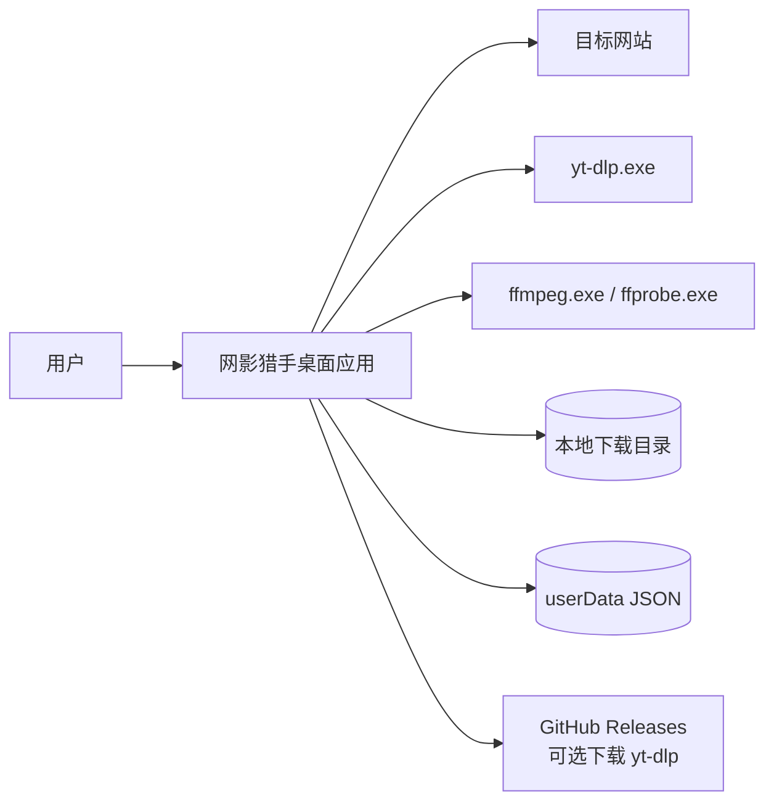

外部依赖：

| 依赖 | 用途 | 是否随包 |
|------|------|----------|
| yt-dlp | 页面解析、下载、格式选择 | 是，`resources/bin/yt-dlp.exe` |
| ffmpeg | 合并音视频、转码 | 是，`resources/bin/ffmpeg.exe` |
| ffprobe | 媒体探测/校验 | 是，`resources/bin/ffprobe.exe` |
| 目标网站 | 用户浏览的内容源 | 否 |
| GitHub Releases | 可选补装 yt-dlp | 否 |

---

### 3. 进程与容器视图

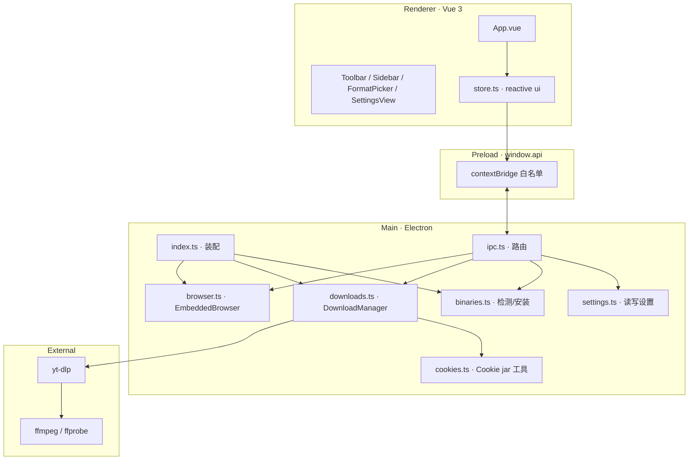

#### 3.1 进程职责

| 进程 | 职责 | Node 能力 |
|------|------|-----------|
| Main | 窗口生命周期、WebContentsView、spawn、文件系统、session、dialog、shell | 完整 |
| Preload | 把有限 API 暴露为 `window.api` | 受限 |
| Renderer | 页面展示、用户交互、响应式状态 | 无直接 Node |
| yt-dlp / ffmpeg | 解析、下载、合并、转码 | 独立进程 |
| BrowserView | 内嵌网页渲染 | 独立 webContents |

#### 3.2 安全边界

- Renderer 不 `require('fs')`、不 `spawn`；
- 所有系统能力通过 `window.api` → IPC → 主进程；
- 内嵌浏览器 `sandbox: true`、`contextIsolation: true`、`nodeIntegration: false`；
- 主窗口当前为 `sandbox: false`，但有 `contextIsolation: true`、`nodeIntegration: false`。

---

### 4. 模块分解

#### 4.1 `src/main/index.ts`

职责：

- 创建 `BrowserWindow`；
- 设置无边框窗口、最小尺寸、背景色、图标；
- 创建 `EmbeddedBrowser`；
- 创建 `DownloadManager`；
- 注册 IPC；
- 启动时检测引擎；
- 处理单实例锁、窗口关闭、退出清理。

关键点：

- `BrowserWindow` 使用 `frame: false`；
- 主窗口 `sandbox: false`（已知安全缺口）；
- `before-quit` 调用 `downloads.shutdown()`；
- `window-all-closed` 在非 macOS 上退出。

#### 4.2 `src/main/browser.ts`

职责：

- 封装 `WebContentsView`；
- 维护 `BrowserState`；
- 导航、后退、前进、刷新、主页；
- 根据 renderer 上报的 bounds 调整视图；
- 权限请求 allowlist；
- `window.open` 和新窗口拦截。

关键实现：

| 方法 | 作用 |
|------|------|
| `constructor` | 创建 WebContentsView，设置 partition 和 UA |
| `allow(url)` | 只允许 http/https 或 home.html 的 file URL |
| `read()` | 读取 URL、标题、历史、加载状态 |
| `push()` | 推送 `browser:state` |
| `setBounds()` | 设置位置/大小，过小时隐藏 |
| `hide()` | 设置页时隐藏 |
| `goHome()` | 加载 `home.html` |
| `navigate()` | 校验 URL 后加载 |
| `back/forward/reload` | 导航控制 |

#### 4.3 `src/main/downloads.ts`

`DownloadManager` 是核心模块，约 760 行。

主要状态：

```ts
tasks: DownloadTask[]
history: HistoryItem[]
children: Map<string, ChildProcess>
stopReason: Map<string, 'pause' | 'cancel'>
browserItems: Map<string, DownloadItem>
samples: Map<string, { bytes: number; at: number }>
lastEmit: Map<string, number>
probeChild: ChildProcess | null
probeToken: number
persistTimer: NodeJS.Timeout | null
```

主要方法：

| 方法 | 职责 |
|------|------|
| `probe(url)` | spawn yt-dlp `-J`，返回 `ProbeResult` |
| `cancelProbe()` | 取消当前解析 |
| `start(request)` | 校验参数、创建任务、入队 |
| `pause(id)` | 暂停 yt-dlp 或浏览器下载 |
| `resume(id)` | 继续暂停/失败任务 |
| `cancel(id)` | 取消任务 |
| `remove(id)` | 移除任务 |
| `clearFinished()` | 清理完成/取消任务 |
| `openTask(id)` | 打开输出文件 |
| `showTask(id)` | 在文件夹中显示 |
| `shutdown()` | 取消解析、杀子进程、flush 持久化 |
| `watchBrowserDownloads()` | 监听 `will-download` |
| `onBrowserProgress()` | 更新浏览器下载进度 |
| `execProbe()` | 执行并解析 probe 子进程 |
| `pump()` | 并发调度 |
| `run(task)` | 执行单个 yt-dlp 下载 |
| `applyLine()` | 把解析结果写入任务 |
| `verifyOutput()` | 校验输出文件 |
| `markStopped()` | 统一完成/失败/取消处理 |
| `pushHistory()` | 写入历史 |
| `touch()/emit()` | 节流推送任务更新 |
| `restore()/flush()` | 恢复/持久化队列和历史 |

#### 4.4 `src/main/binaries.ts`

职责：

- 解析 yt-dlp / ffmpeg 路径；
- 运行 `--version` / `-version` 获取版本；
- 从 GitHub Releases 下载 yt-dlp 到 userData；
- 报告下载进度。

解析优先级：

```text
settings 自定义路径（若存在）
  → resources/bin（项目/包内）
  → PATH
  → missing
```

当前缺口：

- `userData/bin` 未进入 `detectBinaries()` 的候选列表；
- `settings.ts` 的 sanitize 会清空 `ytdlpPath` / `ffmpegPath`；
- 因此“下载引擎”完成后，某些环境下可能仍检测不到。

#### 4.5 `src/main/settings.ts`

职责：

- 默认设置；
- `sanitizeSettings()` 清洗；
- 读写 `userData/settings.json`；
- 确保下载目录存在。

当前固定项：

```text
formatPreference = 'source-max'
filenameTemplate = DEFAULT_TEMPLATE
ytdlpPath = ''
ffmpegPath = ''
useCookies = false
noPlaylist = true
theme = 'dark' | 'light'
```

并发数限制：1–5。

#### 4.6 `src/main/cookies.ts`

职责：

- 从 Electron Session 按 URL 读取 Cookie；
- 生成 Netscape Cookie 文件；
- 文件权限 0600；
- 用完删除。

当前状态：

- 工具函数存在；
- 但 `downloads.ts` 当前将 `cookies` 设为 `null`，下载路径未启用 Cookie 跟随；
- 这是“预留能力”，不是已交付能力。

#### 4.7 `src/main/ipc.ts`

职责：

- 注册所有 `ipcMain.handle` / 事件；
- 解析和基本校验 IPC 入参；
- 调用 `EmbeddedBrowser`、`DownloadManager`、`binaries`、`settings`；
- 推送主进程事件到 renderer。

服务定位：

```ts
interface AppServices {
  getWindow: () => BrowserWindow
  getBrowser: () => EmbeddedBrowser
  getDownloads: () => DownloadManager
}
```

#### 4.8 `src/preload/index.ts`

职责：

- 用 `contextBridge` 暴露 `window.api`；
- 聚合命名空间：
  - `api.bootstrap`
  - `api.browser`
  - `api.downloads`
  - `api.settings`
  - `api.binaries`
  - `api.shell`
  - `api.window`
- 提供 `serialize()` 处理 IPC 结构化克隆。

#### 4.9 `src/shared/types.ts`

共享类型：

- `Settings`
- `BinarySlot` / `BinaryInfo`
- `BrowserState` / `BrowserBounds`
- `MediaFormat`
- `ProbeResult`
- `FormatChoice`
- `DownloadTask`
- `HistoryItem`
- `StartRequest`
- `Bootstrap`
- `InstallProgress`

#### 4.10 `src/shared/ytdlp.ts`

纯逻辑模块，不依赖 Electron：

- `normalizeUrl()`
- `maxVideoHeight()`
- `recommendedPresets()`
- `defaultChoice()`
- `videoFormatSelector()`
- `buildYtDlpArgs()`
- `previewCommand()`
- `parseYtDlpLine()`
- `mapProbeJson()` / `mapFormats()`
- `formatBytes()` / `formatDuration()`

这是单元测试的主要对象。

#### 4.11 `src/renderer/src/store.ts`

职责：

- 创建 Vue `reactive` 单例 `ui`；
- 启动时 `init()` 拉取 bootstrap；
- 订阅主进程事件；
- 封装导航、下载、暂停、继续、取消、设置、引擎安装等动作；
- 维护 `ui.picker`、`ui.tasks`、`ui.history`、`ui.binaries`、`ui.install`。

状态结构（节选）：

```ts
ui = reactive({
  ready: false,
  view: 'browse' | 'settings',
  tab: 'queue' | 'history',
  address: '',
  browser: BrowserState,
  settings: Settings,
  binaries: BinaryInfo,
  tasks: DownloadTask[],
  history: HistoryItem[],
  picker: PickerState | null,
  install: InstallProgress,
  toast: ''
})
```

#### 4.12 组件层

| 组件 | 职责 |
|------|------|
| `App.vue` | 总体布局、主题、浏览器 bounds 上报、快捷键 |
| `Toolbar.vue` | 品牌、导航、地址栏、下载此页、设置、窗口控件 |
| `Sidebar.vue` | 队列/最近 Tab、任务列表、底栏 |
| `TaskCard.vue` | 单任务进度、状态、操作 |
| `FormatPicker.vue` | 推荐档位、高级格式、保存目录、开始下载 |
| `SettingsView.vue` | 保存目录、并发数、关于 |
| `StartPane.vue` | 起始页空态 |
| `WindowControls.vue` | 最小化/最大化/关闭 |

---

### 5. 数据模型

#### 5.1 Settings

| 字段 | 类型 | 当前 UI | 说明 |
|------|------|---------|------|
| `downloadDir` | string | 可编辑 | 默认保存目录 |
| `filenameTemplate` | string | 固定 | 默认 `%(title)s [%(id)s].%(ext)s` |
| `formatPreference` | `ask` / `source-max` / PresetId | 固定 `source-max` | 默认选档 |
| `concurrentDownloads` | number | 可编辑 1–5 | 同时下载数 |
| `proxy` | string | 无 UI | 预留 |
| `ytdlpPath` | string | 无 UI | 预留，sanitize 清空 |
| `ffmpegPath` | string | 无 UI | 预留，sanitize 清空 |
| `theme` | `dark` / `light` | 固定暗色提交 | 主题 |
| `useCookies` | boolean | 无 UI | 当前固定 false |
| `noPlaylist` | boolean | 无 UI | 当前固定 true |

#### 5.2 DownloadTask

```ts
{
  id: string
  engine: 'ytdlp' | 'browser'
  url: string
  title: string
  thumbnail?: string
  status: 'queued' | 'downloading' | 'paused' | 'completed' | 'error' | 'cancelled'
  formatLabel: string
  choice: FormatChoice | null
  outputDir: string
  filenameTemplate: string
  noPlaylist: boolean
  useCookies: boolean
  proxy: string
  progress: number
  indeterminate: boolean
  speed: string
  eta: string
  sizeLabel: string
  message: string
  outputFile?: string
  error?: string
  createdAt: number
  updatedAt: number
}
```

#### 5.3 MediaFormat / ProbeResult

`MediaFormat`：

- `formatId`、`ext`
- `kind`: `video | audio | combined`
- `label`、`detail`
- `height`、`fps`
- `vcodec`、`acodec`
- `filesize`、`tbr`
- `mergeAudio`

`ProbeResult`：

- `ok`、`error`
- `title`、`thumbnail`、`duration`、`extractor`
- `webpageUrl`
- `formats: MediaFormat[]`

#### 5.4 HistoryItem

- 任务结束摘要；
- 最多保留 100 条；
- 包含 `status`、`outputFile`、`formatLabel`、`error`、`finishedAt`。

---

### 6. IPC 契约

#### 6.1 Renderer → Main（invoke）

| Channel | 参数 | 返回/作用 |
|---------|------|-----------|
| `app:bootstrap` | — | Settings / Binaries / Browser / Tasks / History / Version |
| `browser:navigate` | url | 导航 |
| `browser:back` | — | 后退 |
| `browser:forward` | — | 前进 |
| `browser:reload` | — | 刷新 |
| `browser:home` | — | 主页 |
| `browser:get-state` | — | BrowserState |
| `browser:set-bounds` | BrowserBounds | 设置浏览器视图 |
| `downloads:probe` | url | ProbeResult |
| `downloads:probe-cancel` | — | 取消解析 |
| `downloads:start` | StartRequest | DownloadTask |
| `downloads:pause` | id | 暂停 |
| `downloads:resume` | id | 继续 |
| `downloads:cancel` | id | 取消 |
| `downloads:remove` | id | 移除 |
| `downloads:clear-finished` | — | 清理完成/取消 |
| `downloads:open-file` | id | 打开文件 |
| `downloads:show-folder` | id | 打开文件夹 |
| `downloads:list` | — | 任务列表 |
| `downloads:history` | — | 历史列表 |
| `downloads:clear-history` | — | 清空历史 |
| `downloads:remove-history` | id | 移除历史 |
| `settings:get` | — | 读取设置 |
| `settings:set` | Partial<Settings> | 保存设置 |
| `settings:choose-dir` | — | 选择目录 |
| `settings:open-path` | target | 打开路径 |
| `binaries:info` | — | 引擎信息 |
| `binaries:install-ytdlp` | — | 下载 yt-dlp |
| `window:minimize` | — | 最小化 |
| `window:maximize` | — | 最大化/还原 |
| `window:close` | — | 关闭 |
| `window:is-maximized` | — | 最大化状态 |
| `shell:open-external` | url | 打开 https 外链 |
| `shell:copy` | text | 复制文本 |

#### 6.2 Main → Renderer（send）

| Channel | 载荷 | 用途 |
|---------|------|------|
| `browser:state` | BrowserState | 页面状态 |
| `downloads:task` | DownloadTask | 单任务更新 |
| `downloads:list` | DownloadTask[] | 队列整体更新 |
| `downloads:history` | HistoryItem[] | 历史更新 |
| `settings:changed` | Settings | 设置变化 |
| `binaries:info` | BinaryInfo | 引擎状态 |
| `binaries:install-progress` | InstallProgress | 引擎安装进度 |
| `window:maximized` | boolean | 最大化状态 |

---

### 7. 关键流程

#### 7.1 启动与 bootstrap

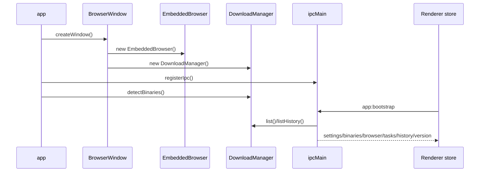

#### 7.2 浏览与 bounds 同步

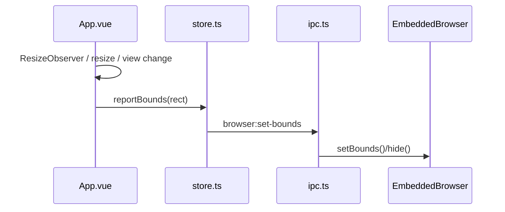

#### 7.3 解析 → 选择 → 开始下载

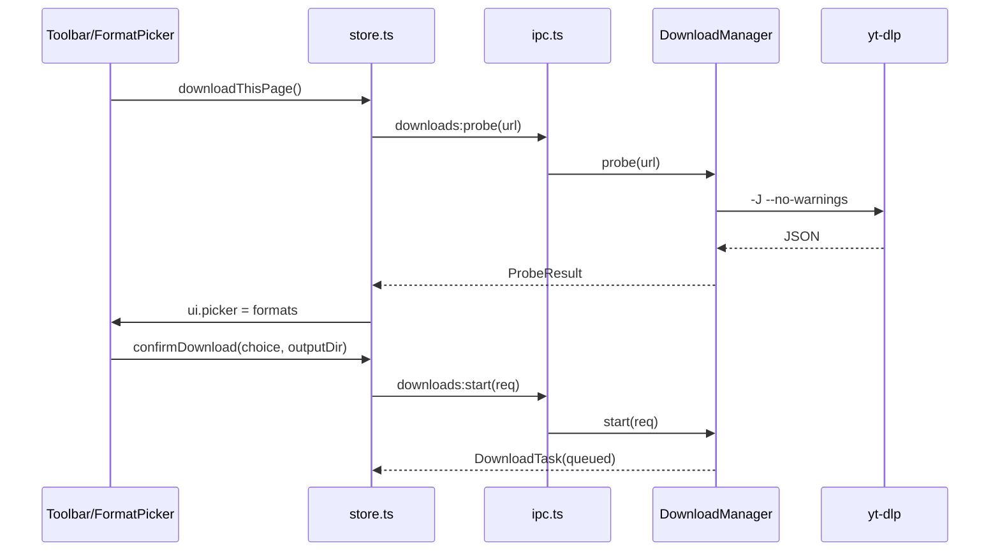

#### 7.4 下载执行与完成

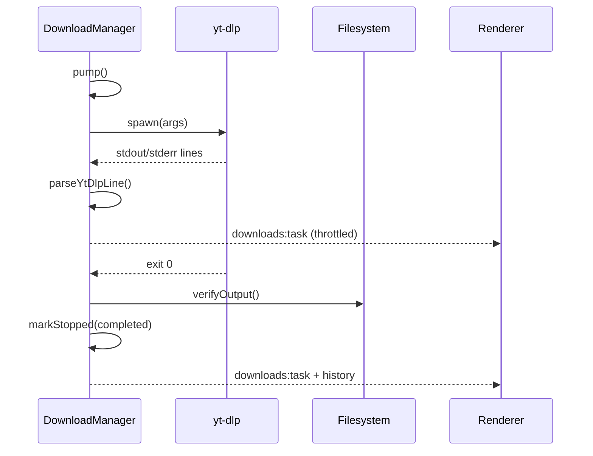

#### 7.5 暂停 / 继续 / 取消

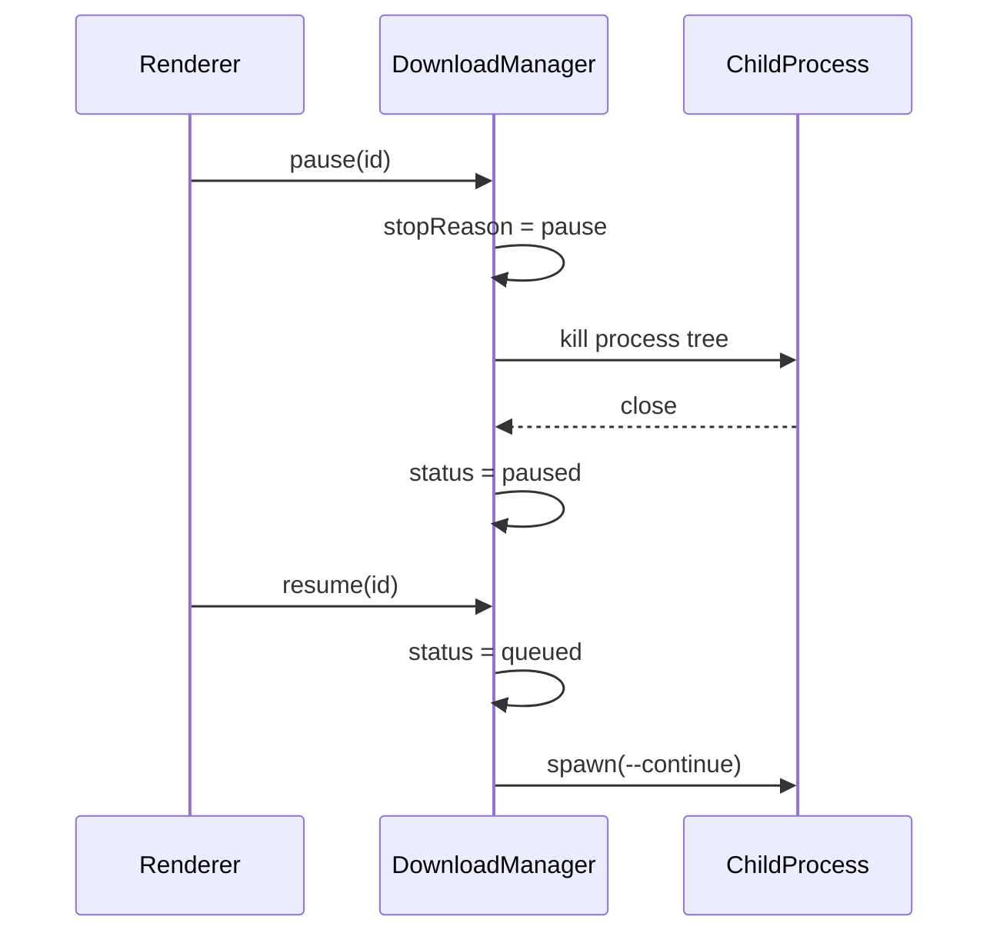

#### 7.6 网页自触发下载

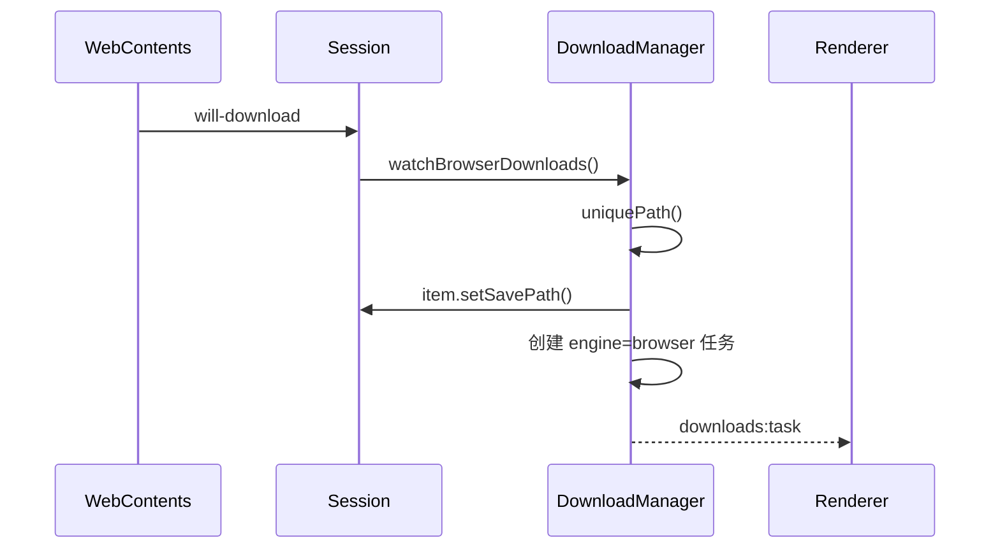

---

### 8. 任务状态机

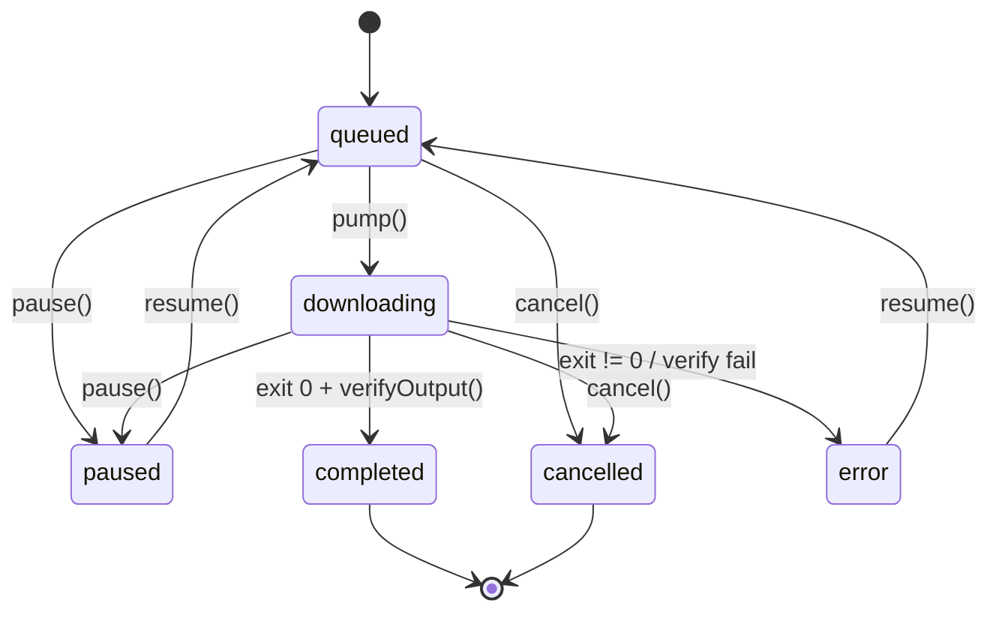

说明：

- `engine='browser'` 的任务由 Electron `DownloadItem` 管理，暂停/继续是真实暂停；
- `engine='ytdlp'` 的暂停是“杀进程 + 续传”；
- `error` 状态允许 `resume()` 重试；
- 完成/失败/取消会进入历史。

---

### 9. 并发与进程管理

#### 9.1 并发调度

```text
active = count(tasks where status='downloading' and engine='ytdlp')
slots = settings.concurrentDownloads - active
queued = tasks where status='queued' and engine='ytdlp'
for task of queued.reverse():
  if slots <= 0: break
  slots -= 1
  run(task)
```

特点：

- 只限制 yt-dlp 任务；浏览器原生下载不占用这个槽位；
- 新任务 `unshift` 到数组前面；
- `queued.reverse()` 让最早入队的先执行；
- `markStopped()` 和 `pump()` 负责释放槽位并继续调度。

#### 9.2 子进程管理

- `children: Map<taskId, ChildProcess>` 保存运行中的 yt-dlp；
- `probeChild` 单独保存解析进程；
- Windows 使用 `taskkill /pid <pid> /t /f` 清理进程树；
- 非 Windows 使用进程组 `process.kill(-pid, 'SIGTERM')`；
- `shutdown()` 在应用退出时取消解析、杀掉全部子进程并 flush 持久化。

#### 9.3 解析取消

- `probeToken` 每次 `cancelProbe()` 自增；
- `probe()` 执行完检查 token 是否变化；
- 变化则返回 `已取消`，避免旧结果覆盖新结果。

---

### 10. 安全架构

#### 10.1 进程隔离

| 项 | 状态 |
|----|------|
| `contextIsolation` | 主窗口/浏览器均为 true |
| `nodeIntegration` | false |
| 主窗口 `sandbox` | **false（待改进）** |
| 浏览器 `sandbox` | true |
| Preload | 只暴露白名单 API |

#### 10.2 导航与外链

- `normalizeUrl()` 只接受 http/https；
- 内嵌浏览器 `will-navigate` / `will-redirect` 只允许 http/https 或 home.html；
- `shell:open-external` 只允许 https；
- 主窗口 `setWindowOpenHandler` 当前直接 `shell.openExternal(details.url)`，**未做协议白名单**，是已知风险。

#### 10.3 命令与参数安全

- `spawn(..., { shell: false })`；
- URL 规范化；
- `formatId` 白名单；
- 代理 scheme 白名单；
- Cookie 文件路径由主进程生成；
- 预览命令不暴露真实 Cookie 路径。

#### 10.4 文件安全

- `safeName()` 清理 Windows 非法字符和控制字符；
- `uniquePath()` 防止重名覆盖；
- 文件名截断到 180 字符；
- 输出文件做存在性和 0 字节校验；
- 下载目录由用户选择，主进程负责创建。

#### 10.5 Cookie

`cookies.ts` 设计：

- 按 URL 读取 session cookies；
- 生成 Netscape 格式；
- 0600 权限；
- 调用方用完 `removeCookieJar()`。

当前状态：

- 工具已存在；
- 下载路径未启用；
- 设置 sanitize 固定 `useCookies=false`。

---

### 11. 持久化

| 文件 | 位置 | 内容 | 写入 |
|------|------|------|------|
| `settings.json` | `app.getPath('userData')` | Settings | 保存设置时立即写 |
| `queue.json` | `app.getPath('userData')` | DownloadTask[] | 任务变化 250ms debounce |
| `history.json` | `app.getPath('userData')` | HistoryItem[] | 任务结束 250ms debounce |

恢复策略：

- `downloading` / `queued` → `paused`；
- 浏览器任务提示“应用重启后，网页下载无法继续”；
- yt-dlp 任务提示“应用已重启，可继续下载”。

持久化优点：

- 无原生依赖；
- 易于调试；
- 便携包不需要数据库。

风险：

- 并发写/异常退出可能留下不完整 JSON；
- 当前 `writeFileSync` 直接覆盖，未做原子写；
- 后续可改为临时文件 + rename。

---

### 12. 构建与部署架构

#### 12.1 开发构建

```text
electron-vite dev
  ├── main → out/main
  ├── preload → out/preload
  └── renderer → Vite dev server
```

#### 12.2 生产构建

```text
npm run build
  ├── typecheck:node
  ├── typecheck:web
  ├── electron-vite build
  └── out/
      ├── main/index.js
      ├── preload/index.js
      └── renderer/
```

#### 12.3 便携打包

`electron-builder.yml` 关键配置：

| 配置 | 值 |
|------|-----|
| `appId` | `app.netshadow.hunter` |
| `productName` | 网影猎手 |
| `win.executableName` | `netshadow-hunter` |
| `win.target` | `dir` |
| `extraResources` | `home.html`、`resources/bin/**` |
| `asarUnpack` | `resources/**` |

产物结构：

```text
dist/win-unpacked/
├── netshadow-hunter.exe
├── *.dll / *.pak / locales/
└── resources/
    ├── app.asar
    ├── app.asar.unpacked/
    ├── home.html
    └── bin/
        ├── yt-dlp.exe
        ├── ffmpeg.exe
        └── ffprobe.exe
```

便携 zip：

```text
scripts/package-portable.ps1
  → npm run build
  → electron-builder --win dir
  → Compress-Archive dist/win-unpacked/* 
  → dist/网影猎手-<version>-portable.zip
```

---

### 13. 测试架构

当前测试：

```text
tests/ytdlp.test.ts
  ├── normalizeUrl
  ├── buildYtDlpArgs
  ├── 预设/音频参数
  ├── 合并音轨
  ├── 非法 formatId / 代理拒绝
  ├── parseYtDlpLine
  ├── mapProbeJson
  ├── recommendedPresets
  ├── defaultChoice
  └── after_move 路径行
```

执行：

```bash
npm test
npm run typecheck
```

后续建议：

- 为 `DownloadManager` 抽离可测试的队列状态机；
- 用 mock yt-dlp 脚本做集成测试；
- 加 Electron E2E（Playwright）；
- 加打包冒烟测试（解压 zip 启动）。

---

### 14. 扩展点

| 方向 | 挂载点 | 注意 |
|------|--------|------|
| Cookie 跟随 | `cookies.ts` + `downloads.run()` | 合规、临时文件、0600、用完删除 |
| DRM 提示 | `parseYtDlpLine()` / `probe()` | 只提示，不绕过 |
| 代理 UI | `Settings.proxy` | 校验 scheme |
| 自定义引擎路径 | `settings.ts` + `binaries.ts` | 当前 sanitize 会清空，需要改 |
| 队列持久化升级 | `downloads.restore()/flush()` | 原子写、版本号 |
| 多标签浏览器 | `browser.ts` | 当前单 WebContentsView |
| 自动更新 | `electron-builder` + updater | 需要签名 |
| 日志系统 | `downloads.ts` | 结构化日志、脱敏 |

---

### 15. 架构决策记录（ADR 摘要）

| 决策 | 理由 | 代价 |
|------|------|------|
| 不自研解析器 | 复用 yt-dlp 覆盖和更新 | 受 yt-dlp 行为限制 |
| WebContentsView | 与 UI 分离、bounds 可控 | 需要手动同步布局 |
| Vue reactive store | 轻量、直接 | 状态集中，需注意复杂度 |
| JSON 持久化 | 简单、可调试 | 无事务、并发写风险 |
| source-max 默认 | 降低选择成本 | 高级用户仍需手动格式 |
| H.264/AAC 优先 | Windows 兼容性 | 可能不是最高压缩效率 |
| 便携 dir 优先 | 分发简单 | 无自动更新/安装体验 |
| 主进程管进程 | 安全边界清晰 | 主进程复杂度上升 |

---

### 16. 文件地图

```text
src/
├── main/
│   ├── index.ts        # 应用装配、窗口、生命周期
│   ├── ipc.ts          # IPC 路由
│   ├── browser.ts      # WebContentsView 封装
│   ├── downloads.ts    # DownloadManager
│   ├── binaries.ts     # 引擎检测/安装
│   ├── settings.ts     # 设置读写
│   └── cookies.ts      # Cookie jar 工具
├── preload/
│   ├── index.ts        # window.api
│   └── index.d.ts      # 类型声明
├── renderer/
│   ├── index.html
│   └── src/
│       ├── App.vue
│       ├── main.ts
│       ├── store.ts
│       ├── components/
│       └── styles/app.css
└── shared/
    ├── types.ts
    └── ytdlp.ts
```

---

### 17. 已知问题清单

| 编号 | 问题 | 优先级 | 建议 |
|------|------|--------|------|
| A1 | `userData/bin` 未纳入引擎检测 | P1 | `detectBinaries()` 增加候选 |
| A2 | 主窗口 `setWindowOpenHandler` 未限制协议 | P1 | 只允许 http/https/mailto |
| A3 | 主窗口 `sandbox: false` | P2 | 评估改 true |
| A4 | Cookie 跟随未启用 | P1 | 合规接入临时 Cookie |
| A5 | 自定义引擎路径被 sanitize 清空 | P2 | 明确产品策略 |
| A6 | DRM 错误未专门映射 | P2 | 增加提示 |
| A7 | 无 E2E 测试 | P2 | 加 Playwright |
| A8 | 无代码签名 | P2 | 发布前配置证书 |
| A9 | 持久化非原子写 | P3 | 临时文件 + rename |
| A10 | 打包图标未配置 `win.icon` | P3 | 设置应用图标 |

---

### 18. 合并说明

本文已合并原 `01`–`06` 六份文档；`docs/` 下不再保留分散版本。后续如拆分文档，应以本文为母版。